This is Lecture 3, *Aircraft Configuration*. It covers the major arrangement choices: wing, fuselage, engines, tail, and landing gear. For each one: what type, where, and how many, and what each option gains and costs. Each choice is a candidate row in the A03 morphological chart. Your team chooses the rows.

:::{note} What to take from this lecture
- The major arrangement choices, and the options for each.
- What each option gains and what it costs.
- Which options matter most for your RFP.
:::

## Why aircraft look the way they do

:::{prf:definition} Configuration
:label: def-configuration

The {term}`configuration` is the type, location, and count of each major component: wing, fuselage, engines, tail, and landing gear.
:::

Requirements drive the choices: cabin size, speed, range, and field length. Every choice is a compromise. Engineering judgment makes the initial choice, and the analysis has to confirm it.

:::{admonition} Navy Jet Trainer
:class: navy

The configuration answers your A01 requirements and CONOPS. Each box below names the RFP content the choice must meet.
:::

## Wing placement

The schematics are front views: fuselage, wing, and fin.

::::{grid} 1 3 3 3

:::{card}
:header: High wing
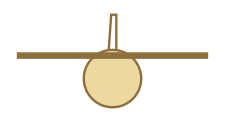

Gains: roomy fuselage, engine and propeller clearance, easy loading.

Costs: usually needs a T-tail; long or podded gear.

Examples: C-17, DHC-8, Twin Otter.
:::

:::{card}
:header: Mid wing
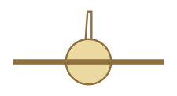

Gains: lowest drag, most aerobatic, suits area-ruled fuselages.

Costs: the spar passes through the fuselage volume, or heavy frames carry it.

Examples: F-104, sailplanes, aerobatic types.
:::

:::{card}
:header: Low wing

Gains: spar under the cabin, short gear, engine access.

Costs: requires dihedral; under-wing engine clearance.

Examples: Boeing 737, CRJ, most trainers.
:::

::::

:::{admonition} Navy Jet Trainer
:class: navy

Wing height affects the cockpit sightlines and the gear length. The RFP constrains the sightlines through the over-the-nose view on the 3.5° {term}`FCLP` glide slope. The gear carries the FCLP touchdown loads. The RFP gives no sink rate.
:::

## Fuselage cross-section

::::{grid} 1 3 3 3

:::{card}
:header: Circular

Gains: easy to pressurize, good volume, easy construction.

Costs: curved doors and windows; little fuselage lift.

Examples: jet transports, PC-12.
:::

:::{card}
:header: Rectangular

Gains: simplest construction, flat doors, usable volume.

Costs: higher drag; not pressurized.

Examples: Shorts 360, Islander.
:::

:::{card}
:header: Chined or blended
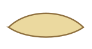

Gains: fuselage lift, lower drag.

Costs: difficult construction, poor volume use, hard to pressurize.

Examples: SR-71, blended-wing-body concepts.
:::

::::

:::{admonition} Navy Jet Trainer
:class: navy

The cockpit section must fit the pilot size range the RFP states: heights from 62 in to 77 in, sitting heights from 31 in to 40.9 in, and sitting eye heights from 26 in to 31.4 in, in two ejection seats. The eye height drives the over-the-nose view.
:::

## Jet engine and inlet placement

The schematics are side views, nose to the left.

::::{grid} 1 3 3 3

:::{card}
:header: Buried
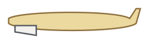

Gains: lower drag, less wetted area, no nacelles.

Costs: uses internal volume; the inlet duct loses pressure in turns and at angle of attack.

Examples: fighters, jet trainers.
:::

:::{card}
:header: Podded, under the wing
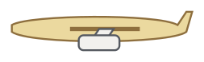

Gains: easy maintenance, clean inflow, wing bending relief.

Costs: pylon and nacelle drag; ground clearance.

Examples: Boeing 737, transports.
:::

:::{card}
:header: Podded, aft fuselage
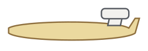

Gains: clean wing, quiet cabin, short gear.

Costs: usually forces a T-tail; aft weight.

Examples: business jets, CRJ.
:::

::::

:::{admonition} Navy Jet Trainer
:class: navy

Every trainer in the cohort buries its engine. The inlets differ. Inlet placement must work at high angle of attack across the training envelope.
:::

## Propeller and motor placement

The RFP title says jet trainer. Decide from your A01 deconstruction whether that closes the propulsion row.

::::{grid} 1 2 4 4

:::{card}
:header: Tractor
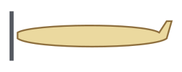

Gains: propeller in clean air, cooling air, forward CG.

Costs: propeller wash over the fuselage, noise, nose length.
:::

:::{card}
:header: Pusher
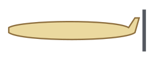

Gains: clean fuselage flow, forward view, room for a canard.

Costs: rotation clearance, dirty inflow, cooling.
:::

:::{card}
:header: Wing-mounted

Gains: bending relief; wash over the flaps helps at low speed.

Costs: nacelle interference, engine-out yaw.
:::

:::{card}
:header: Combination
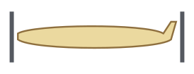

Gains: centerline thrust, engine-out economy.

Costs: noise, rear propeller clearance.
:::

::::

## Tail arrangement

The schematics are rear views: fuselage, fin, and horizontal tail.

::::{grid} 1 2 3 3

:::{card}
:header: Conventional
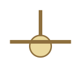

Gains: simple, light, well placed for downwash. Costs: trim drag.
:::

:::{card}
:header: T-tail
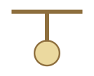

Gains: suits high wings and aft engines. Costs: heavier; deep stall possible.
:::

:::{card}
:header: Cruciform
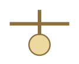

Gains: clears the wing wake. Costs: deep stall still possible.
:::

:::{card}
:header: V-tail

Gains: less area and drag. Costs: ruddervators; needs more area than the projection suggests.
:::

:::{card}
:header: H-tail

Gains: short verticals, endplate effect, shields the exhaust. Costs: heavier horizontal.
:::

::::

:::{admonition} Navy Jet Trainer
:class: navy

Spin entry and recovery are certified behaviors. Tail position relative to the wing wake at high angle of attack is a selection criterion.
:::

## Canard and tail-less

::::{grid} 1 1 2 2

:::{card}
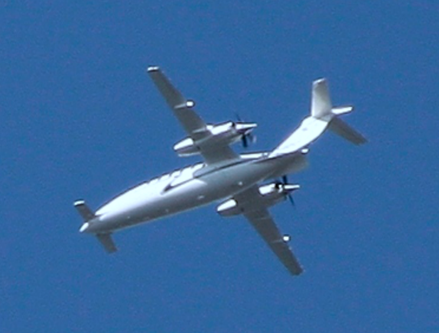

Piaggio P.180 Avanti, a three-surface aircraft. Photo by Ximeg, [CC BY-SA 3.0](https://creativecommons.org/licenses/by-sa/3.0/), via [Wikimedia Commons](https://commons.wikimedia.org/wiki/File:Piaggio_P.180_Avanti_above_Jena.jpg).
:::

:::{card}
- **Canard.** Trims with positive lift and can stall before the wing. Natural stability is harder, rotation authority at $C_{L,max}$ is limited, and pilot visibility suffers. Examples: Viggen, Starship, Vari-Eze.
- **Tail-less or flying wing.** Less weight and drag. Needs a near-zero pitching-moment wing and careful control design. Fuselage volume is limited. Examples: B-2, Concorde.
- **Winglets as vertical stabilizers** suit canard pushers. The wing structure then carries the tail loads.
:::

::::

:::{important}
Unconventional options enter the Pugh matrix like any other. Each claimed advantage is scored against a requirement.
:::

## Landing gear arrangement

The gear surrounds the center of gravity and allows rotation. The schematics are top views: fuselage, wing line, and wheels.

::::{grid} 2 3 3 3

:::{card}
:header: Tricycle
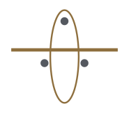

Gains: ground stability, good rotation. Costs: heavy nose gear.
:::

:::{card}
:header: Tail-dragger
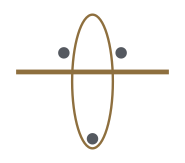

Gains: light, propeller clearance, rough fields. Costs: ground handling.
:::

:::{card}
:header: Bicycle
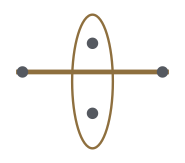

Gains: narrow fuselage. Costs: outriggers, hard rotation.
:::

:::{card}
:header: Single main
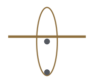

Gains: least weight and volume. Costs: skids, no rotation.
:::

:::{card}
:header: Quadricycle
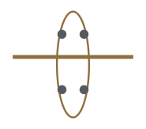

Gains: narrow body, short gear. Costs: difficult rotation.
:::

:::{card}
:header: Multi-bogey
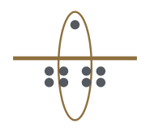

Gains: spreads heavy weights. Costs: size and complexity.
:::

::::

:::{admonition} Navy Jet Trainer
:class: navy

FCLP sink rates size the gear. The RFP gives no sink rate, so state the value you assume and its source. The arrangement decides where that weight goes.
:::

## The morphological chart

:::{prf:definition} Morphological chart
:label: def-morphological-chart

A {term}`morphological chart` has one row per major arrangement choice and one column per option. One pick per row is a configuration.
:::

- Compose many configurations. Check each against your requirements and CONOPS.
- Record every disqualifier with the requirement or RFP statement it violates.
- The selection method, the Pugh matrix, is in .

:::{table} Illustration of a morphological chart. Your rows come from your own decomposition.
:label: tbl-morphological-illustration

| Function | Option | Option | Option |
| --- | --- | --- | --- |
| Generate lift | monoplane | biplane | blended |
| Provide thrust | tractor propeller | pusher propeller | podded jet |
| Store energy | fuel | battery | hybrid |
| Ground operations | tricycle | tail-dragger | skids |
| Control pitch | aft tail | canard | tail-less |

:::

:::{admonition} Navy Jet Trainer
:class: navy

A03 Deliverable 2: choose the rows from your requirements and CONOPS, then compose at least three distinct configurations.
:::

(trainer-cohort)=
## The trainer cohort

The eight aircraft of the A02 database. Photos via Wikimedia Commons.

::::{grid} 2 2 4 4

:::{card}
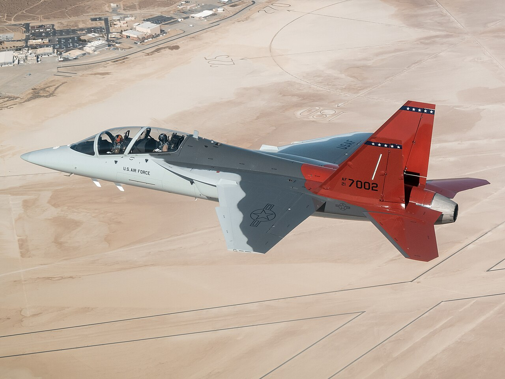

**Boeing T-7A Red Hawk.** U.S. Air Force photo by Bryce Bennett, public domain.
:::

:::{card}

**Boeing T-45 Goshawk.** U.S. Navy photo by Lt. j.g. John A. Ivancic, public domain.
:::

:::{card}
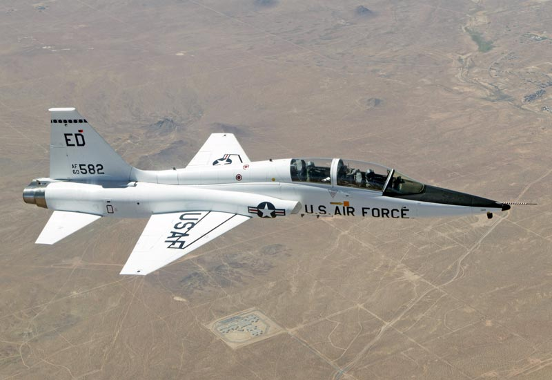

**Northrop T-38 Talon.** U.S. Department of Defense, public domain.
:::

:::{card}
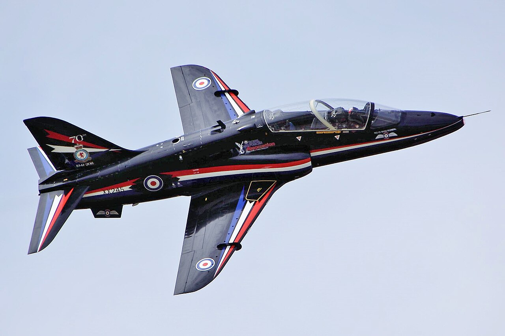

**BAE Systems Hawk.** Photo by Tim Felce, [CC BY-SA 2.0](https://creativecommons.org/licenses/by-sa/2.0/), via [Wikimedia Commons](https://commons.wikimedia.org/wiki/File:Hawk_-_RIAT_2011_%286122004254%29.jpg).
:::

:::{card}
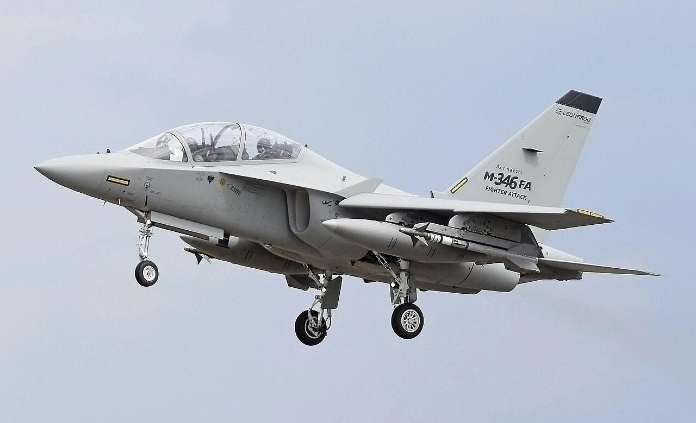

**Leonardo M-346 Master.** Photo by Adrian Pingstone, public domain.
:::

:::{card}
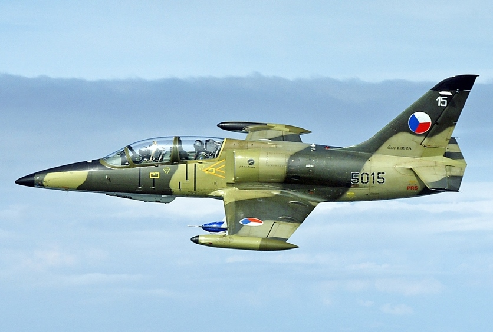

**Aero L-39 Albatros.** Photo by Milan Nykodym, [CC BY-SA 4.0](https://creativecommons.org/licenses/by-sa/4.0/), via [Wikimedia Commons](https://commons.wikimedia.org/wiki/File:L-39ZA_Albatros_%28cropped%29.jpg).
:::

:::{card}
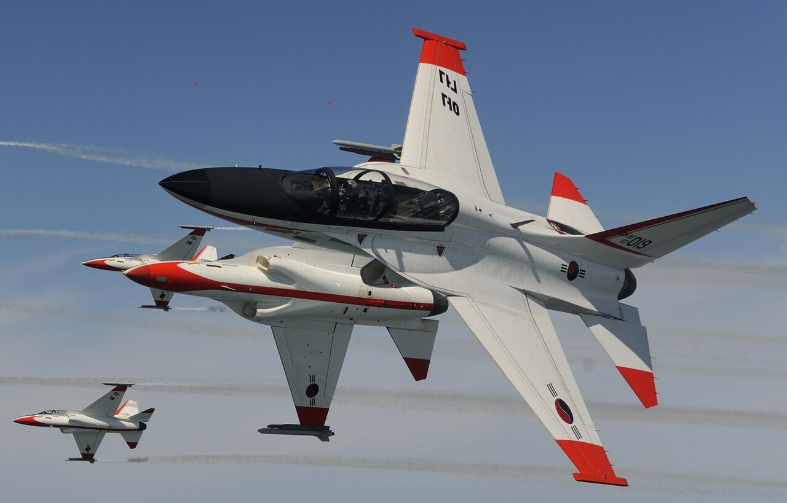

**KAI T-50 Golden Eagle.** Photo by Korea Aerospace Industries, [CC BY 2.0](https://creativecommons.org/licenses/by/2.0/), via [Wikimedia Commons](https://commons.wikimedia.org/wiki/File:KAI_T-50_Golden_Eagle_Demo_flight.jpg).
:::

:::{card}
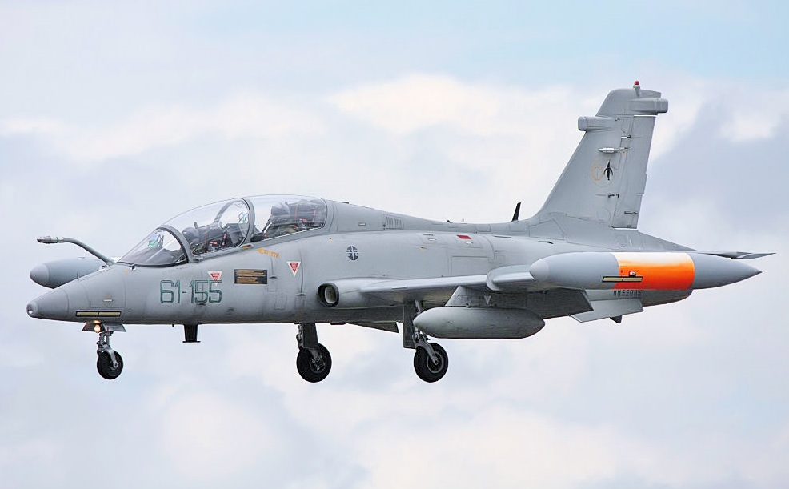

**Aermacchi MB-339.** Photo by Tim Felce, [CC BY-SA 2.0](https://creativecommons.org/licenses/by-sa/2.0/), via [Wikimedia Commons](https://commons.wikimedia.org/wiki/File:MB339_-_RIAT_2008_%282674540983%29.jpg).
:::

::::

:::{exercise} Read the cohort
:label: ex-cohort-configuration

For each of the eight trainers, identify the wing placement, the inlet placement, the tail arrangement, and the landing gear. Which options does the cohort share, and where does it differ?
:::

:::{important} Summary
- Wing placement, cross-section, engine placement, tail, gear: one pick per row is a configuration.
- Every option trades something. Record the trade.
- A03 Deliverable 2: the chart and at least three distinct configurations. Your team chooses the rows.
:::

:::{seealso} Reading
Raymer (2018), Chapter 4. Concept generation and selection follow in .
:::

## References

- Raymer, D. P., *Aircraft Design: A Conceptual Approach*, 6th ed., AIAA Education Series, 2018.
