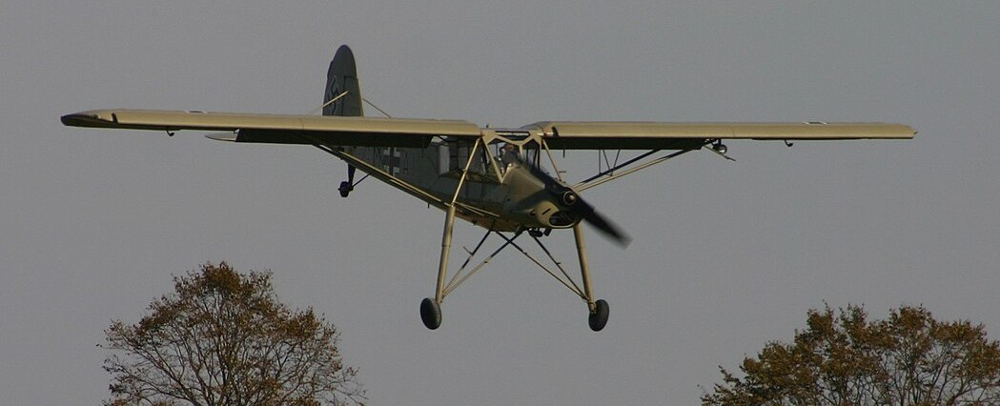
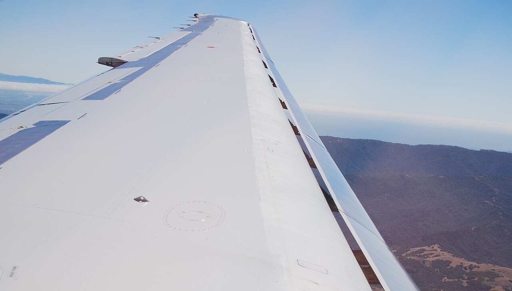

This is the first part of Lecture 6, *High-Lift Systems*. The lecture has four parts: the requirements, the devices, the wing, and the field length. This page covers the first two. The second part, , covers the wing and the field length. The sources are Gudmundsson (2022), Chapters 8, 10, 16, 18, and 23, together with Anderson (1999) and MIL-STD-3013. The figures are redrawn after the figures on the slides and reduced to the point each slide makes.

:::{note} What to take from this lecture
- The RFP's field lengths are MIL-STD-3013B distances. State which one you use.
- A trailing-edge {term}`flap` shifts the lift curve up and to the left. A {term}`slat` extends it.
- Device increments are section values from published data. The wing value needs the flapped span and the hinge-line sweep.
- Prefer the simplest system that meets the requirement.
:::

## Field requirements

:::{table} What the RFP asks of the high-lift system. Every value comes from the RFP.
:label: tbl-field-requirements

| Item | Navy Jet Trainer |
| --- | --- |
| Takeoff | Takeoff distance 5,000 ft and {term}`critical field length` 6,000 ft, at MTOW |
| Landing | Landing distance 5,000 ft, at {term}`MLW` |
| Atmosphere | ISA, 5,000 ft density altitude |
| Surface | Not stated |
| Definitions | MIL-STD-3013B |
| Low speed | {term}`FCLP`; full view over the nose on a 3.5° glide slope |

:::

:::{admonition} Navy Jet Trainer
:class: navy

The RFP requires a description of the high-lift devices, and drag polars for the takeoff and landing configurations.
:::

## Where the definitions come from

:::{table} The distances MIL-STD-3013 defines. MIL-STD-3013 (2003 issue), Sections 3.2 and 3.8; the RFP cites revision B, so confirm against it.
:label: tbl-milstd-distances

| Distance | Definition |
| --- | --- |
| Ground run | Brake release to main-wheel liftoff. Zero wind, dry hard runway, no slope |
| Total takeoff distance | Ground run plus the air distance to clear 50 ft |
| Critical field length | Accelerate to the engine-failure speed, then lift off or stop in the same distance |
| Total landing distance | Air run from 50 ft plus ground roll |

:::

:::{admonition} Navy Jet Trainer
:class: navy

The RFP says "takeoff distance" and "landing distance." State which MIL-STD-3013B distance you use.
:::

## What high lift does

:::{figure} figures/flap-lift-curve.svg
:label: fig-flap-lift-curve
:alt: Section lift coefficient against angle of attack for four cases. The clean airfoil peaks at about 1.5 near 15 degrees. With a trailing-edge flap the curve is shifted up and to the left, peaking higher at a lower angle. With a slat the clean curve extends to a higher angle and a higher peak. With flap and slat together the curve is both shifted and extended, with the highest peak.
:width: 85%

How a flap and a slat change the lift curve. Schematic, after Gudmundsson (2022), Figures 8-58 and 8-61.
:::

::::{grid} 1 2 4 4

:::{card}
:header: Two mechanisms
More camber. Delayed separation.
:::

:::{card}
:header: Trailing-edge flap
The lift curve shifts up and to the left. $C_{l_{max}}$ rises, $\alpha_{stall}$ falls.
:::

:::{card}
:header: Slot or slat
The lift curve extends. $C_{l_{max}}$ and $\alpha_{stall}$ both rise.
:::

:::{card}
:header: Purpose
Lower speeds and shorter fields. $L/D$ for the takeoff climb. Drag for a steeper approach. A lower {term}`deck angle`.
:::

::::

## Trailing-edge devices

:::{figure} figures/trailing-edge-devices.svg
:label: fig-trailing-edge-devices
:alt: Five airfoil sketches with the trailing-edge device deployed. Plain: the aft part of the airfoil hinged down. Split: a plate on the lower surface hinged down, the upper surface unchanged. Single-slotted: the flap moved down and back with a gap to the wing. Double-slotted: a vane and a flap, each with its own gap. Fowler: the flap moved well back, extending the chord, and deflected.
:width: 100%

The trailing-edge devices, with the section increment $\Delta C_{l_{max}}$ at the stated deflection. After Gudmundsson (2022), Figures 10-22, 10-28, 10-33, 10-37, and 10-40.
:::

:::{table} Trailing-edge devices. The increment is the section $\Delta C_{l_{max}}$ at the stated deflection, with a flap chord of 0.2 $c$ for the plain and split flaps and 0.3 $c$ for the slotted and Fowler flaps. After Gudmundsson (2022), Table 10-4.
:label: tbl-trailing-edge-devices

| Device | Increment | Gains | Costs | Examples |
| --- | --- | --- | --- | --- |
| Plain | +0.66 at 45° | Simple, light | Separation above 15° | Control surfaces |
| Split | +0.89 at 60° | Simple, steep approach | High drag | Douglas DC-3 |
| Single-slotted | +1.32 at 40° | Less drag than split | Offset hinge or track | Cirrus SR22 |
| Double-slotted | +1.40 at 55° to 60° | Attached flow at high deflection | Weight, complexity | DHC-6 Twin Otter |
| Fowler | +2.24 at 40° | Adds chord and camber | Tracks, nose-down moment | Cessna aircraft, Boeing 727 |

:::

:::{admonition} Navy Jet Trainer
:class: navy

A04 Deliverable 3: choose from these types and from the leading-edge devices.
:::

## Leading-edge devices

:::{figure} figures/leading-edge-devices.svg
:label: fig-leading-edge-devices
:alt: Four airfoil sketches with the leading-edge device deployed. Droop nose: the nose hinged down. Fixed slot: the nose piece separated from the wing by a permanent gap. Krüger flap: a plate hinged from the lower surface and swung forward under the nose. Slat: the nose piece moved forward and down, opening a slot.
:width: 90%

The leading-edge devices, with the section increments $\Delta C_{l_{max}}$ and $\Delta\alpha_{stall}$. After Gudmundsson (2022), Figures 10-2, 10-8, 10-10, and 10-14.
:::

:::{table} Leading-edge devices. The numbers are the section $\Delta C_{l_{max}}$ and $\Delta\alpha_{stall}$. After Gudmundsson (2022), Table 10-2.
:label: tbl-leading-edge-devices

| Device | Increment | Gains | Costs | Examples |
| --- | --- | --- | --- | --- |
| Droop nose | +0.58, stall +7.8° | Light, suits thin wings | Sharp curvature at the hinge | Lockheed F-104 |
| Fixed slot | +0.45, stall +9.0° | No mechanism | Drag in cruise | Fieseler Storch |
| Krüger flap | +0.30, stall +5.0° | Clean upper surface in cruise | Two positions only | Boeing 707, 727 |
| Slat | +0.84, stall +11.0° | Highest increment | Tracks and actuation | A-4 Skyhawk, MD-80 |

:::

:::{admonition} Navy Jet Trainer
:class: navy

A thin wing sized for Mach 0.78 and Mach 0.90 has a low clean $C_{L_{max}}$. Which leading-edge device do the trainers in your A02 database use?
:::

## Devices in service

::::{grid} 1 1 3 3

:::{card}

**Fieseler Storch.** A fixed slot along the full span. Photo by Alan Wilson, [CC BY-SA 2.0](https://creativecommons.org/licenses/by-sa/2.0/), via [Wikimedia Commons](https://commons.wikimedia.org/wiki/File:Fieseler_Fi156A-1_Storch_GM%2BAI_(G-STCH)_(6727843327).jpg).
:::

:::{card}

**MD-80.** The slat deployed for landing, seen from the cabin. Photo by Bill Abbott, [CC BY-SA 2.0](https://creativecommons.org/licenses/by-sa/2.0/), via [Wikimedia Commons](https://commons.wikimedia.org/wiki/File:MD-80_wing,_landing,_focus_on_leading_edge_slats_(7984780550).jpg).
:::

:::{card}

**Boeing 747-400.** Krüger flaps on the leading edge, triple-slotted flaps on the trailing edge. Photo by Aeroprints.com, [CC BY-SA 3.0](https://creativecommons.org/licenses/by-sa/3.0/), via [Wikimedia Commons](https://commons.wikimedia.org/wiki/File:B-HUK_Boeing_744F_Cathay_Pacific_Cargo_(7628201648).jpg).
:::

::::

Device types per Gudmundsson (2022), Sections 10.2 and 10.3.

:::{admonition} Navy Jet Trainer
:class: navy

The aircraft in your A02 database show which devices your class of aircraft uses. Identify them before you choose.
:::

## Increment and deflection

:::{figure} figures/increment-vs-deflection.svg
:label: fig-increment-deflection
:alt: Section maximum lift increment against flap deflection for four flap types, each a smooth curve through the table values with the values marked. The plain flap rises to 0.66 at 45 degrees, its slope easing beyond 15 degrees. The split flap rises to 0.89 at 60 degrees. The single-slotted flap rises to 1.32 at 40 degrees and only 1.37 at 50. The Fowler flap rises fastest, to 2.24 at 40 degrees. A shaded band marks the takeoff settings of 10 to 20 degrees.
:width: 85%

How the section increment grows with deflection. Schematic through the values of {numref}`tbl-trailing-edge-devices`. Gudmundsson (2022), Figure 10-48, shows the measured curves from NACA Report 648 at a Reynolds number of 0.4 million.
:::

- Add the section increments to the clean section $C_{l_{max}}$.
- Flap chord: 20 to 35% of the wing chord.
- Plain flap: separation above 15°.
- Single-slotted flap: little gain beyond 40°.
- Takeoff: 10 to 20°. Landing: full deflection.
- The published chart is at a low Reynolds number. Read the trend there; take the value from data at your Reynolds number.

:::{admonition} Navy Jet Trainer
:class: navy

A04: the increment comes from published data for the device type, with the source cited.
:::

## Typical maximum lift by system

:::{table} Typical wing maximum lift coefficients by high-lift system, divided by the cosine of the wing sweep. Complexity rises down the table. After Anderson (1999), Table 5.3.
:label: tbl-typical-clmax

| Trailing edge | Leading edge | Takeoff flap | Landing flap | $C_{L_{max}}/\cos\Lambda$, takeoff | $C_{L_{max}}/\cos\Lambda$, landing |
| --- | --- | ---: | ---: | ---: | ---: |
| Plain flap | | 20° | 60° | 1.4 to 1.6 | 1.7 to 2.0 |
| Single-slotted flap | | 20° | 40° | 1.5 to 1.7 | 1.8 to 2.2 |
| Fowler, single-slotted | | 15° | 40° | 2.0 to 2.2 | 2.5 to 2.9 |
| Fowler, double-slotted | | 20° | 50° | 1.7 to 1.95 | 2.3 to 2.7 |
| Fowler, double-slotted | Slat | 20° | 50° | 2.3 to 2.6 | 2.8 to 3.2 |
| Fowler, triple-slotted | Slat | 20° | 40° | 2.4 to 2.7 | 3.2 to 3.5 |

:::

:::{admonition} Navy Jet Trainer
:class: navy

Compare your estimate with this range. A value outside it needs an explanation.
:::

## Selecting the system

:::{table} Comparison table for the high-lift system. Score as in the airfoil comparison table. After Gudmundsson (2022), Table 10-1 and Section 10.1.2.
:label: tbl-highlift-selection

| Group | Measure | Clean | System 1 | System 2 | System 3 |
| --- | --- | :---: | :---: | :---: | :---: |
| Lift | Takeoff and landing $C_{L_{max}}$ | | | | |
| Lift | Margin over the required $C_{L_{max}}$ | | | | |
| Attitude | $\alpha_{stall}$ and deck angle on approach | | | | |
| Drag | Added drag in cruise | | | | |
| Drag | $L/D$ in the takeoff configuration | | | | |
| System | Weight | | | | |
| System | Wing structure, actuation, and control | | | | |
| System | Ice protection of the leading edge | | | | |
| System | Development and maintenance cost | | | | |

:::

Prefer the simplest system that meets the requirement.

:::{admonition} Navy Jet Trainer
:class: navy

A04: justify the choice against the field requirement the RFP states.
:::

:::{seealso}
Continue with : partial-span flaps, the wing partition method, trim and deck angle, the FCLP approach, the drag penalty, climb, and the field length that sets the required maximum lift. The references for both parts are at the end of that page.
:::
