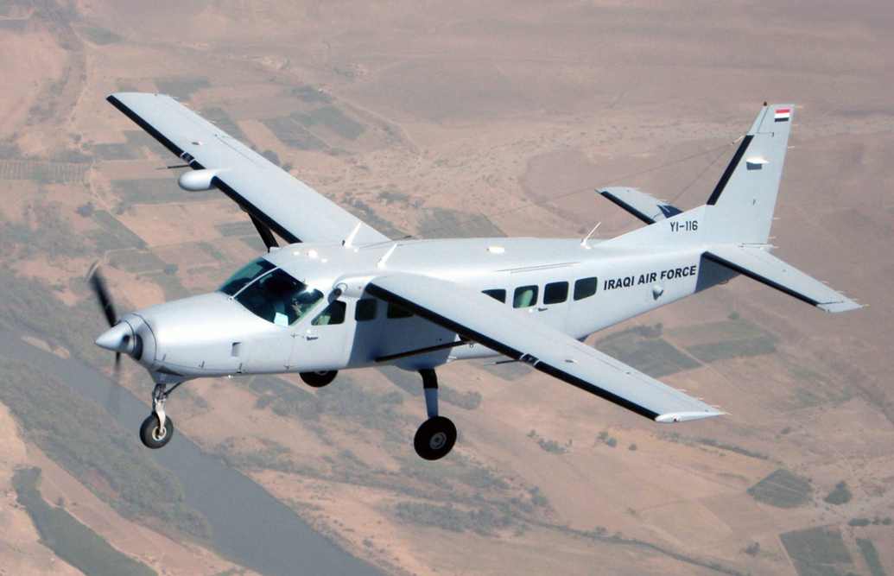
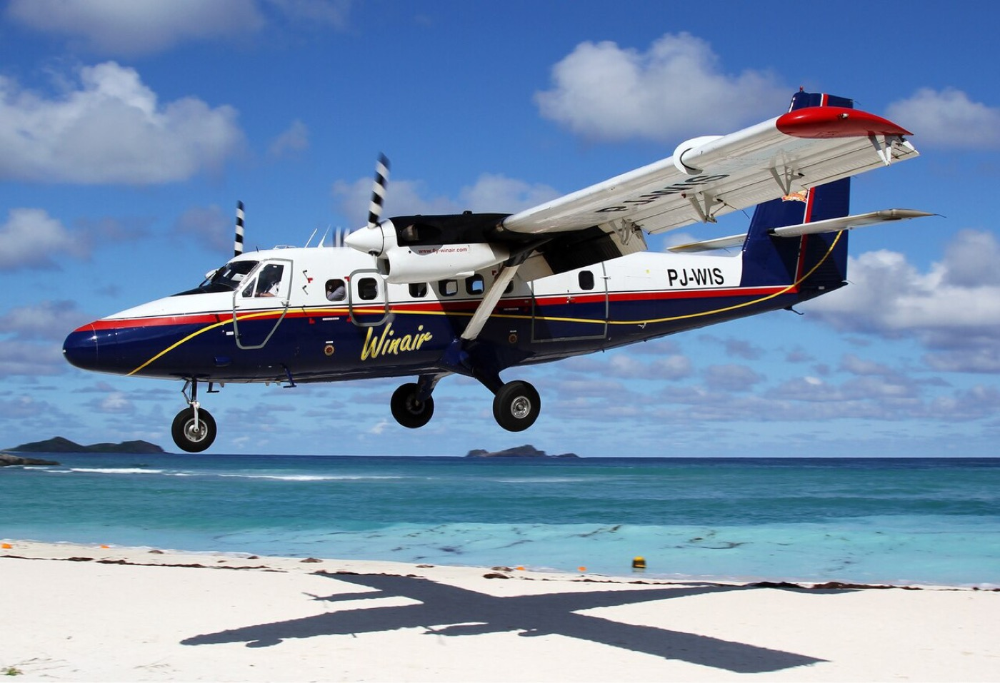
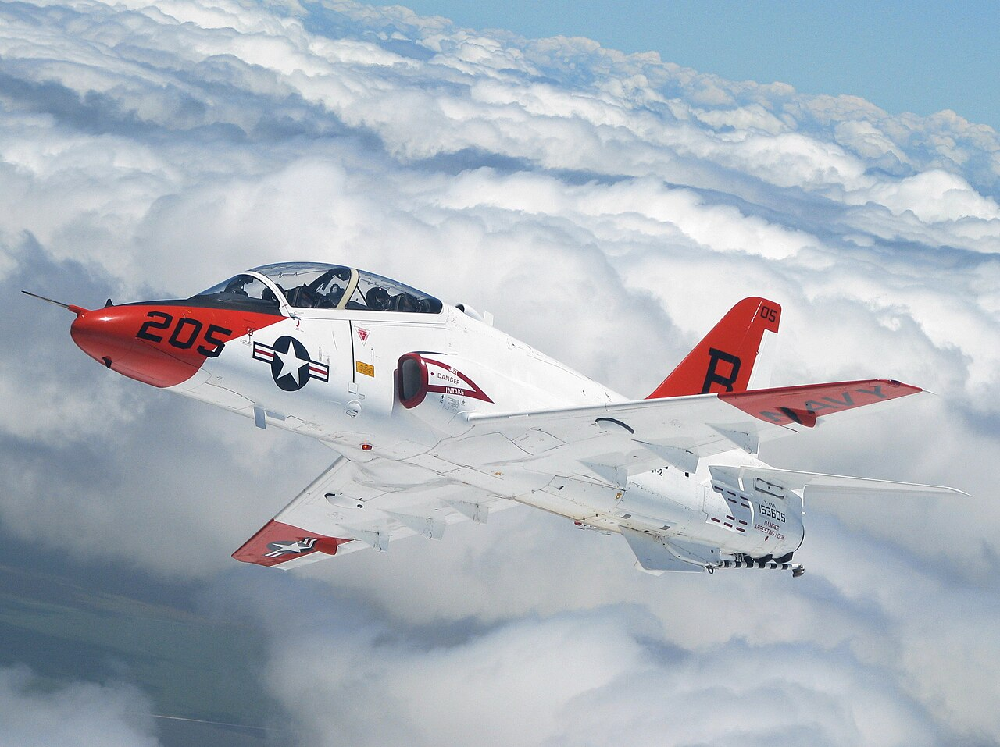
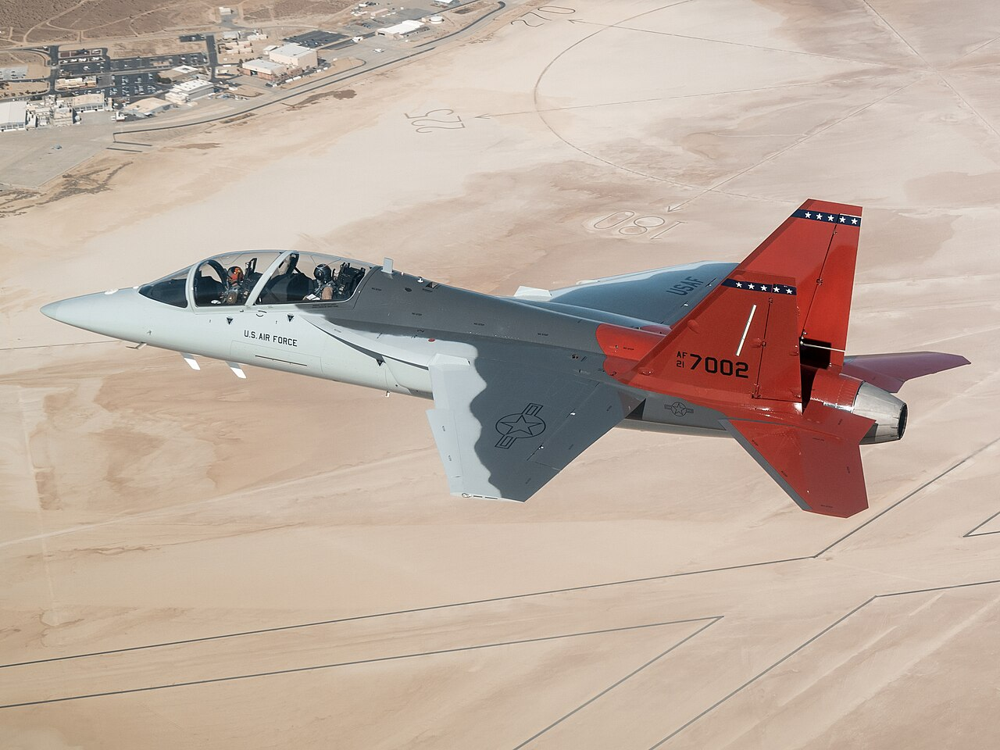
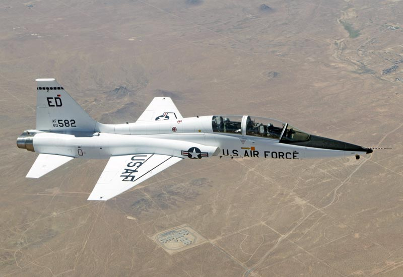
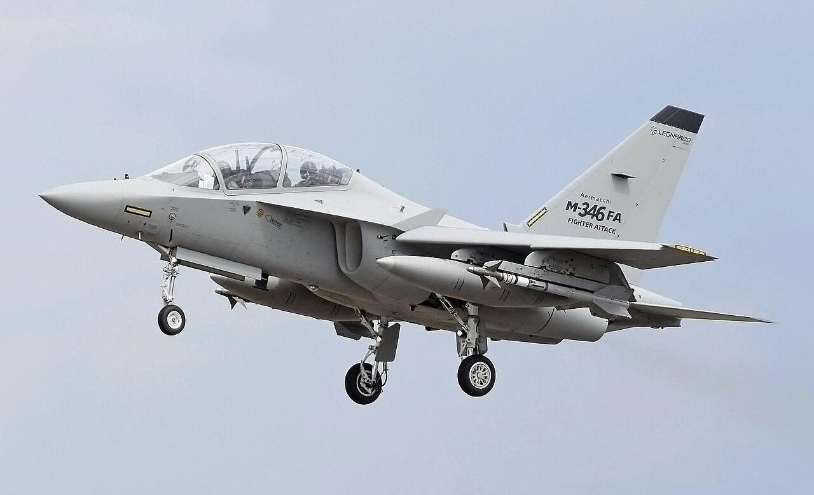

This is the first part of Lecture 8, *Propulsion Selection and Integration*. The lecture has three parts: engine selection, engine models, and integration. This page covers what the RFP asks of the propulsion model, the engine classes, published engine data, and the number and location of the engines. The second part, , covers the thrust and fuel-flow models and the engine deck. The third part, , covers the inlet, the nozzle, and the design sequence. The sources are Gudmundsson (2022), Chapters 7 and 14; Nicolai and Carichner (2010), Chapters 15 and 18 and Appendix J; Mattingly et al. (2002); and Raymer (2018). The figures are redrawn after the figures on the slides and reduced to the point each slide makes.

:::{note} What to take from this lecture
- The speed, altitude, and field requirements narrow the engine class.
- Published engine data are uninstalled, sea-level static values. The sizing code needs installed thrust and fuel flow over the whole envelope.
- The number and location of the engines follow from the requirements and the failure cases.
:::

## Requirements on the propulsion model

:::{table} What the RFP asks of the propulsion model. Every value comes from the RFP; T is the threshold, O the objective.
:label: tbl-propulsion-requirements

| Item | Navy Jet Trainer |
| --- | --- |
| Engine data | None given. Required: engine type, manufacturer, and model; documented installed thrust and fuel-flow models |
| {term}`Ratings <rating>` in the missions | Idle thrust for the taxi and the training-flight descents; takeoff thrust for 1 minute; military thrust for 30 minutes at Mach 0.60 and 10,000 ft |
| Fuel allowances | {term}`FCLP`, 30 minutes at approach speed; ferry approach, 10 minutes at approach speed; reserve of 30 or 45 minutes at maximum endurance speed |
| Performance at {term}`MTOW` less 50% fuel | Maximum operating speed Mach 0.78 (T), Mach 0.90 (O) at 25,000 ft; {term}`specific excess power` 90 ft/s (T), 125 ft/s (O) and sustained +4.0 g (T), +6.0 g (O) at 15,000 ft |
| Field at MTOW, 5,000 ft density altitude | Takeoff distance 5,000 ft; {term}`critical field length` 6,000 ft |

:::

:::{admonition} Navy Jet Trainer
:class: navy

Which published sources will you cite for the engine, and which for its installed thrust and fuel flow?
:::

## What the sizing code needs

:::{prf:definition} Thrust-specific fuel consumption
:label: def-tsfc

The {term}`TSFC`, $C$, is the fuel weight flow divided by the thrust, $C = \dot{w}_{fuel}/T$. Its unit is lb of fuel per hour per lb of thrust, written 1/h.
:::

The initial sizing of [Lecture 2](../lecture-02/mission-fuel.md) used one $C$ per mission segment in the Breguet range and endurance equations. It treated $C$ as a property of the engine, with no effect of speed or altitude. The sizing code and the performance analysis need more:

- Thrust against altitude, Mach number, and throttle setting.
- Fuel flow at the same points.
- Installed values: thrust and fuel flow after the inlet and nozzle losses, the power extraction, and the bleed.

## Where each engine class operates

Each engine class covers a band of altitude and Mach number ({numref}`fig-operational-map`).

:::{figure} figures/operational-map.svg
:label: fig-operational-map
:alt: Altitude against Mach number, with one closed outline per engine class that rises from sea level to a ceiling and returns at a higher Mach number. The piston classes reach: light sport, about 10,000 feet and Mach 0.24; normally aspirated singles, 16,000 feet and 0.38; turbo-normalized, 25,000 feet and 0.47. The turbine classes reach: single turboprops, 31,000 feet and 0.58; twin turboprops, 42,000 feet and 0.80; high-bypass turbofan airliners, 42,000 feet and 0.92; high-bypass turbofan business jets, 51,000 feet and 0.97. At 25,000 feet the outlines end at Mach 0.56 for single turboprops, 0.73 for twin turboprops, and 0.90 for both turbofan classes. Dotted lines bound the fighters, past Mach 2 and 60,000 feet.
:width: 100%

Where each engine class operates. Outlines read from Gudmundsson (2022), Figure 7-1.
:::

- Normally aspirated pistons fly low and slow. Their power falls with altitude.
- Single turboprops reach about Mach 0.6, and twin turboprops about Mach 0.8.
- Turbofans cover high subsonic speeds and high altitudes.
- Afterburning engines reach supersonic speeds.

:::{admonition} Navy Jet Trainer
:class: navy

Place the speed and altitude requirements of the RFP on this map before you choose a class. Which classes cover all of them?
:::

## Propulsive efficiency

An engine produces thrust by accelerating a mass flow $\dot{m}$ from the flight speed $V_\infty$ to the exit speed $V_e$. The thrust and the propulsive efficiency $\eta_{prop}$ are

:::{math}
:label: eq-propulsive-efficiency
T = \dot{m}\,(V_e - V_\infty), \qquad \eta_{prop} = \frac{2}{1 + V_e/V_\infty}
:::

:::{figure} figures/propulsive-efficiency.svg
:label: fig-propulsive-efficiency
:alt: Propulsive efficiency against Mach number for the engine classes, under a strip that names the class used in each Mach range: fixed-pitch propeller to Mach 0.25, constant-speed propeller to 0.43, turboprop to 0.65, high-bypass to low-bypass turbofan to 1.0, and low-bypass turbofan with afterburner or turbojet above. The constant-speed propeller peaks near 0.84 around Mach 0.35 and falls to 0.68 by Mach 0.58. The turboprop peaks near 0.84 around Mach 0.5 and falls to 0.73 by Mach 0.74. The high-bypass turbofan reaches 0.85 at Mach 1, the low-bypass turbofan 0.85 at Mach 1.3, and the turbojet 0.94 at Mach 2. Four fixed-pitch propeller curves peak lower and earlier: general aviation 0.76 near Mach 0.25, self-launch sailplane 0.70, large and small RC models 0.56 and 0.44.
:width: 85%

Propulsive efficiency by engine class, and the class used in each Mach range. Schematic, after Gudmundsson (2022), Figure 7-2.
:::

- A large mass flow with a small velocity change gives high efficiency. The propeller and the high-bypass fan work this way.
- A small mass flow with a large velocity change gives high thrust per unit of mass flow. The turbojet works this way.
- Propeller efficiency falls above about Mach 0.6 as the tip Mach number rises.

## Engine classes

:::{table} Engine classes compared. After Gudmundsson (2022), Sections 7.2 to 7.4 and Tables 7-9 to 7-11, and Nicolai and Carichner (2010), Table J.1.
:label: tbl-engine-classes

| Class | Gains | Costs | Examples |
| --- | --- | --- | --- |
| Piston | Low cost; low fuel consumption at low speed | Power falls with altitude unless turbocharged; heavy for its power; avgas | Continental IO-550 (Cirrus SR22) |
| Turboprop | High power for its weight; jet fuel; reliability; efficient up to about Mach 0.6 | Cost; high fuel consumption at part throttle; the propeller limits the speed | PT6A (DHC-6, King Air) |
| Turbojet | Simple; small frontal area; high speed | Highest subsonic TSFC; noise | TRS-18 (BD-5J) |
| Low-bypass turbofan | Thrust at high Mach number; compact; lower TSFC than a turbojet | Higher TSFC than a high-bypass turbofan | Adour, F124 ({term}`bypass ratio` 0.5 to 0.8) |
| High-bypass turbofan | Lowest TSFC at Mach 0.7 to 0.85 | Diameter; thrust falls with speed and altitude | FJ44 (bypass ratio 3.2 to 4.1), CFM56 (5 to 6.6) |

:::

The Cessna 208 flies on one PT6A of the turboprop row, and the DHC-6 on two. Photos via Wikimedia Commons.

::::{grid} 1 2 2 2

:::{card}

**Cessna 208 Caravan.** One PT6A. U.S. Air Force photo by Lt. Col. Scott Voskovitch, public domain.
:::

:::{card}

**DHC-6 Twin Otter.** Two PT6A. Photo by Timo Breidenstein, [GFDL 1.2](https://www.gnu.org/licenses/old-licenses/fdl-1.2.html), via [Wikimedia Commons](https://commons.wikimedia.org/wiki/File:WinAir_De_Havilland_Canada_DHC-6-300_Twin_Otter_Breidenstein.jpg).
:::

::::

## Engines in the trainer cohort

Four aircraft of the [trainer cohort](#trainer-cohort) carry these engines. The engine variant changes with the aircraft version. Check the maker's data. Photos via Wikimedia Commons.

::::{grid} 2 2 4 4

:::{card}

**Boeing T-45 Goshawk.** One F405 (Adour Mk 871). U.S. Navy photo by Lt. j.g. John A. Ivancic, public domain.
:::

:::{card}

**Boeing T-7A Red Hawk.** One F404-GE-103. U.S. Air Force photo by Bryce Bennett, public domain.
:::

:::{card}

**Northrop T-38 Talon.** Two J85-GE-5. U.S. Department of Defense, public domain.
:::

:::{card}

**Leonardo M-346 Master.** Two F124-GA-200. Photo by Adrian Pingstone, public domain.
:::

::::

## Turbojet and turbofan

:::{figure} figures/turbojet-turbofan.svg
:label: fig-turbojet-turbofan
:alt: Two engines in section, flow from left to right, with the stations numbered 1 to 7 below. The turbojet has one stream: air enters at the flight speed through the inlet, passes the compressor, the diffuser, the burner, and the turbine, and leaves through the exhaust nozzle at the exit speed. The turbofan adds a fan behind the inlet and a duct around the core. Part of the inlet air goes through the core; the rest, the bypass air, flows around the core through the duct.
:width: 80%

A turbojet has one stream. A turbofan splits the air between the core and the bypass duct. Schematic, after Gudmundsson (2022), Figures 7-30 and 7-33.
:::

:::{prf:definition} Bypass ratio
:label: def-bypass-ratio

The {term}`bypass ratio` is the bypass mass flow divided by the core mass flow, $\mathrm{BPR} = \dot{m}_{bypass}/\dot{m}_{core}$. With an inlet mass flow $\dot{m}_i$, the core takes $\dot{m}_{core} = \dot{m}_i/(\mathrm{BPR}+1)$.
:::

- A higher bypass ratio gives a lower TSFC and a larger fan. The thrust also falls faster as Mach number rises.
- An afterburner burns fuel after the turbine. It adds thrust at a much higher TSFC. Only turbojets and low-bypass turbofans carry one.

## TSFC values

:::{table} TSFC of jet engines for initial sizing, in 1/h. Raymer (2018), Table 3.3.
:label: tbl-tsfc-initial

| Engine | Cruise | Loiter |
| --- | ---: | ---: |
| Turbojet | 0.9 | 0.8 |
| Low-bypass turbofan | 0.8 | 0.7 |
| High-bypass turbofan | 0.5 | 0.4 |

:::

:::{table} Published takeoff values of three turbofans, uninstalled. Gudmundsson (2022), Table 7-11.
:label: tbl-tsfc-published

| Engine | Bypass ratio | Thrust (lb) | TSFC (1/h) |
| --- | ---: | ---: | ---: |
| Larzac 04-C6 | 1.13 | 2,966 | 0.71 |
| JT15D-5A | 3.3 | 2,900 | 0.551 |
| FJ44-2A | 4.1 | 2,300 | 0.460 |

:::

- TSFC is lowest at sea-level static conditions. The cruise value is higher.
- The installed value is higher still: inlet and nozzle losses, power extraction, and bleed.
- Engine makers rarely publish cruise and loiter values.

## Published turbofan data

:::{table} Published data for seven turbofans: uninstalled, sea-level static, without afterburner. An excerpt sorted by thrust, not a list of candidates. Nicolai and Carichner (2010), Table J.1.
:label: tbl-turbofan-data

| Engine | Thrust (lb) | TSFC (1/h) | Bypass ratio | Weight (lb) | Thrust/weight | Application |
| --- | ---: | ---: | ---: | ---: | ---: | --- |
| F404-GE-100D | 11,000 | 0.80 | 0.3 | 1,802 | 6.1 | A-4S |
| F124-GA-100 | 6,400 | 0.81 | 0.5 | 1,100 | 5.8 | L-159 |
| Adour Mk 871 (F405-RR-401) | 5,990 | 0.78 | 0.8 | 1,306 | 4.6 | T-45 |
| Adour Mk 861 | 5,710 | 0.74 | 0.8 | 1,240 | 4.6 | Hawk |
| TFE731-5 | 4,304 | 0.48 | 3.5 | 852 | 5.1 | BAe 125, C-101 |
| JT15D-5C | 3,190 | 0.57 | 1.8 | 665 | 4.8 | S.211A |
| FJ44-1C | 1,500 | 0.46 | 3.4 | 459 | 3.3 | Saab SK 60 |

:::

:::{admonition} Navy Jet Trainer
:class: navy

The RFP asks for models of the installed thrust and fuel flow. What separates the values in {numref}`tbl-turbofan-data` from installed values at your flight conditions?
:::

## Number and location

:::{table} Where a jet engine goes. After Gudmundsson (2022), Section 7.3.
:label: tbl-engine-location

| Location | Gains | Costs |
| --- | --- | --- |
| Podded | Engine fire isolated from the airframe | Pylon drag; ground clearance |
| Buried | Low wetted area | Fireproofing weight, over 100 lb even on a small aircraft; inlet and exhaust ducts |

:::

[Lecture 3](../lecture-03/configuration.md) shows the locations as schematics.

With two engines, the engine-out case adds three items (Gudmundsson 2022, Section 15.2.5, shows them on a propeller twin):

1. The thrust left after the failure, and the climb it gives.
2. The drag of the failed engine, windmilling or stopped, and the trim drag of the yawed aircraft.
3. The yawing moment of the live engine's thrust and the failed engine's drag. It sizes the fin and the rudder for the minimum control speed $V_{mc}$ ([Lecture 10](../lecture-10/lateral-and-controls.md)).

:::{admonition} Navy Jet Trainer
:class: navy

The choice of one engine or two sets the cost, the weight, and the engine-out case. Which requirements and which failure cases decide the number for your aircraft?
:::

:::{seealso}
Continue with : the thrust lapse, TSFC, a published engine deck, installed performance, thrust sizing, and rubber-engine scaling. The references for the three parts are at the end of .
:::
