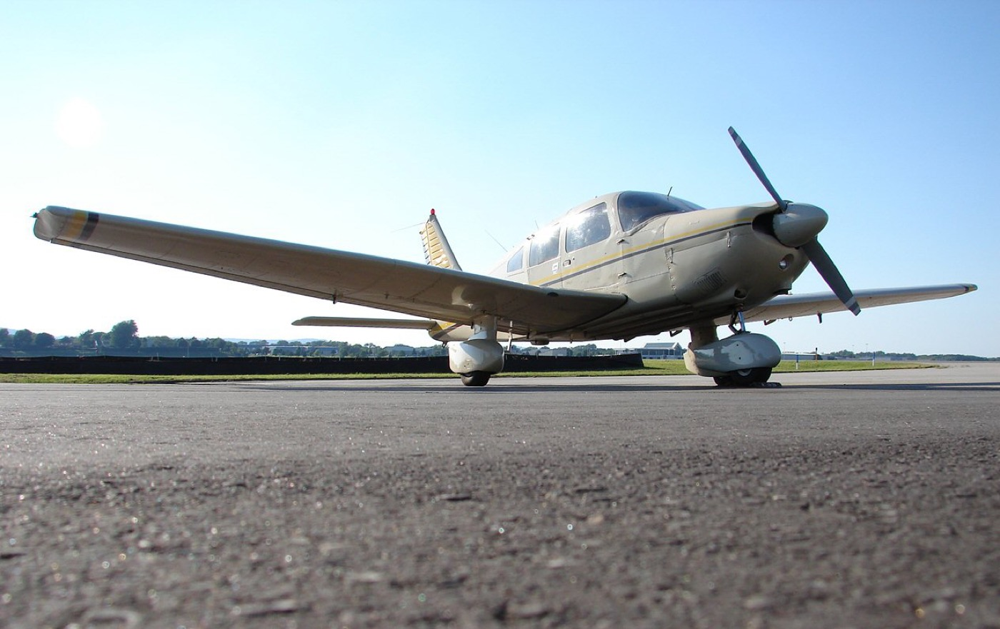
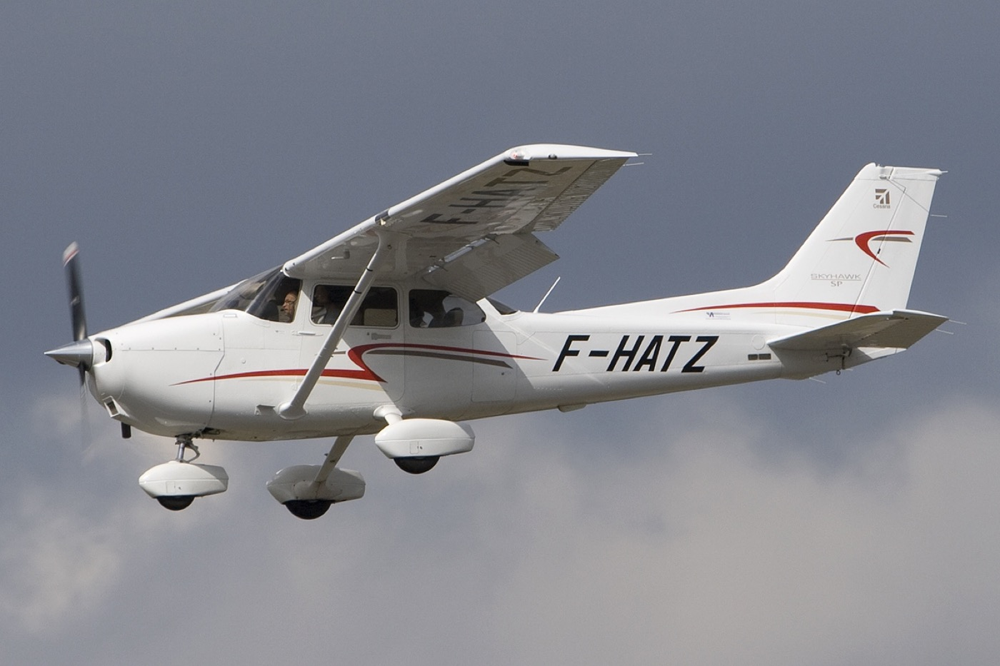
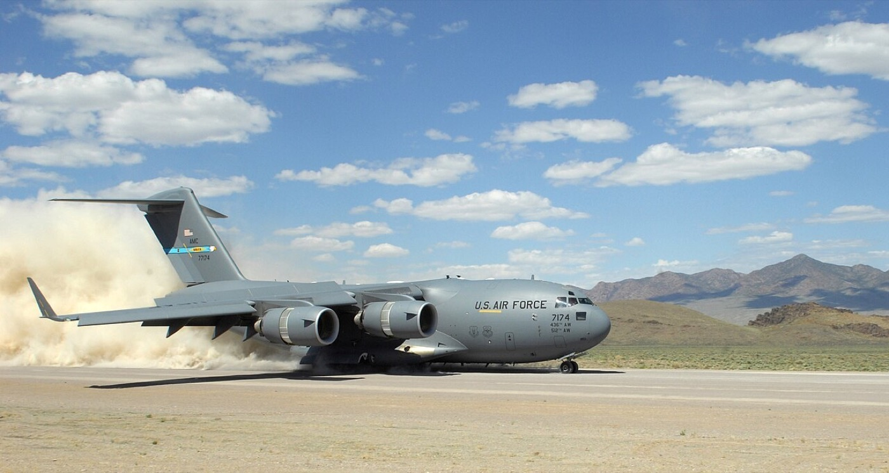
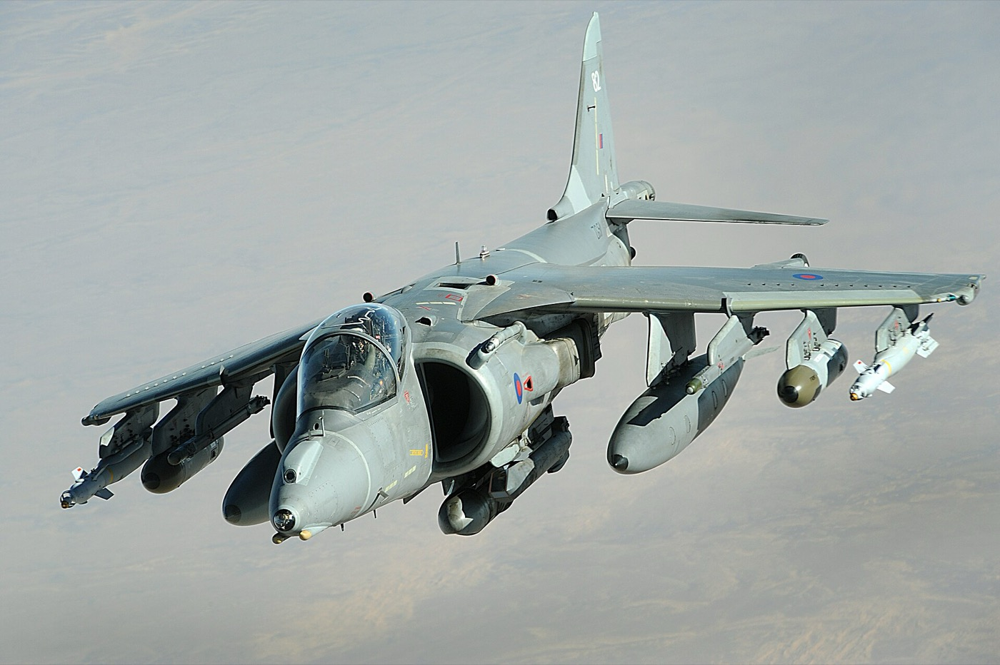

This is the fourth part of Lecture 10, *Stability and Control*. It covers steps 5 to 8 of the method: the fin and its three checks, the dihedral effect, the control surfaces and the flight control system, and the check with a vortex-lattice tool. It follows , , and , and closes with the work for the week. The figures are redrawn after the figures on the slides.

:::{note} What to take from this lecture
- The fin is sized from a volume coefficient and checked for the engine-out case, crosswind, and spin.
- Wing height and sweep set most of the dihedral effect. The dihedral angle adjusts the rest.
- Each control surface has one condition that sizes it.
:::

## Steps 5 and 6: requirements

Directional stability, step 5, requires a positive yaw stiffness $C_{n\beta}$:

:::{math}
:label: eq-cn-beta-requirement
C_{n\beta} = \frac{\partial C_n}{\partial\beta} > 0, \qquad C_n = 0 \ \text{at}\ \beta = 0
:::

The target is +0.05 to +0.15 per rad (Gudmundsson 2022, Section 25.2.3). Existing aircraft spread from 0.02 to 0.3 (his Figure 25-6).

Lateral stability, step 6, requires a negative dihedral effect $C_{\ell\beta}$:

:::{math}
:label: eq-cl-beta-requirement
C_{\ell\beta} = \frac{\partial C_\ell}{\partial\beta} < 0, \qquad C_\ell = 0 \ \text{at}\ \beta = 0
:::

The range is −0.15 to −0.05 per rad (Gudmundsson 2022, Section 25.2.4). A value outside the range is a handling problem, treated under dynamic stability.

:::{figure} figures/cn-beta.svg
:label: fig-cn-beta
:alt: Yawing moment coefficient against sideslip angle, with the wind from the right positive. A solid line through the origin rises with sideslip and is labeled stable, C n beta greater than zero. A dashed line through the origin falls with sideslip and is labeled unstable.
:width: 75%

A stable aircraft yaws into the wind; for $C_\ell$ the signs reverse. Schematic, after Gudmundsson (2022), Section 25.2.
:::

:::{admonition} Navy Jet Trainer
:class: navy

MIL-HDBK-516C applies MIL-STD-1797, and MIL-STD-1797 states flying qualities by level. Which level do you claim for each of these derivatives?
:::

## Step 5: fin area

:::{figure} figures/fin-arm.svg
:label: fig-fin-arm
:alt: Top view of a jet trainer, nose to the left, with a swept wing, a swept horizontal tail, and the fin seen edge-on along the centerline at the tail. A dimension b spans the wing from tip to tip. A dimension l v runs along the fuselage from a dot at the quarter chord of the wing mean chord to a dot at the quarter chord of the fin mean chord.
:width: 65%

The span and the fin arm in the fin volume coefficient. Schematic.
:::

The fin volume coefficient relates the fin area $S_v$ and the fin arm $l_v$ to the wing area and the span. Solved for the fin area:

:::{math}
:label: eq-fin-volume
V_v = \frac{S_v\, l_v}{S\, b} \quad\Rightarrow\quad S_v = V_v\,\frac{S\, b}{l_v}
:::

Take $V_v$ for the class from the table of [part 2](longitudinal-stability.md). $S$ and $b$ come from the design point, and $l_v$ from the fuselage length. The result does not depend on the CG. The three checks below confirm the area or increase it. Draw the fin on the three-view at this size; the three-view carries the tail moment arms.

Typical values are $AR_v$ of 1.3 to 2.0 and $\lambda_v$ of 0.3 to 0.6. A fin under a T-tail has $AR_v$ of 0.7 to 1.2, and fighters 0.6 to 1.4 (Raymer 2018, Table 4.3).

## Step 5: yaw stiffness and the three checks

The fin's part of the yaw stiffness is

:::{math}
:label: eq-cn-beta-fin
C_{n\beta}^{V} = \eta_v\,\frac{S_v\,l_{v,cg}}{S\,b}\,C_{L\alpha}^{V}\Big(1 + \frac{\partial\sigma}{\partial\beta}\Big)
:::

Here the arm $l_{v,cg}$ runs from the CG to the fin aerodynamic center, because the moments are about the CG. It changes with the CG position and differs from the $l_v$ of {eq}`eq-fin-volume`. $\eta_v$ is the dynamic-pressure ratio at the fin, and $\sigma$ the sidewash angle, not the density ratio of [Lecture 9](../lecture-09/constraint-method.md). The factor $\eta_v\,(1 + \partial\sigma/\partial\beta)$ comes from a wing-body correlation and is 0.8 to 1.3 (Gudmundsson 2022, Section 25.3, Eq. 25-28; Nelson 1998, Chapter 2).

:::{table} The parts of $C_{n\beta}$.
:label: tbl-cn-beta-parts

| Part | Sign | Driver |
| --- | --- | --- |
| Fin | Positive | $V_v$, $C_{L\alpha}^{V}$, the sidewash |
| Fuselage | Negative | The side area ahead of the CG |
| Wing sweep | Positive | Small; grows with $C_L$ |

:::

Three checks can size the fin (Gudmundsson 2022, Sections 11.2.4 and 25.5.3):

1. The engine-out case at the minimum control speed $V_{mc}$, at the aft CG, within the rudder deflection you allow.
2. A crosswind landing with the crosswind your certification basis requires, inside the rudder limit, and a sideslip of at least 15° without excessive rudder (Gudmundsson 2022, Section 11.1.2).
3. Spin recovery, with the rudder outside the wake of the horizontal tail in the spin.

## Step 6: dihedral effect

:::{figure} figures/dihedral.svg
:label: fig-dihedral
:alt: Rear view of a jet trainer with both half wings raised at the dihedral angle, capital gamma, measured from a horizontal dotted line. The wind comes from the right, a positive sideslip. The lift on the right half wing, toward the wind, is about twice the lift on the left. A curved arrow under the fuselage turns counterclockwise: the aircraft rolls away from the wind, left half wing down.
:width: 70%

With a dihedral angle $\Gamma$, the half wing toward the wind sees an angle of attack higher by $\beta\,\Gamma$ and lifts more. Schematic, after Gudmundsson (2022), Figure 25-14.
:::

:::{table} The parts of $C_{\ell\beta}$. Nelson (1998), Chapter 2.
:label: tbl-cl-beta-parts

| Part | $C_{\ell\beta}$ | Note |
| --- | --- | --- |
| Dihedral angle $\Gamma$ | Negative | About $-C_{L\alpha}^{W}\,\Gamma/4$ for an untapered wing |
| Sweep $\Lambda$ | Negative | Grows with $C_L$; strong at low speed |
| High wing | Negative | Adds dihedral effect |
| Low wing | Positive | Removes dihedral effect |

:::

:::{table} Dihedral angle in degrees by wing position. Raymer (2018), Table 4.2.
:label: tbl-dihedral-guidelines

| Wing | Low | Mid | High |
| --- | --- | --- | --- |
| Unswept | 5 to 7 | 2 to 4 | 0 to 2 |
| Swept, subsonic | 3 to 7 | −2 to 2 | −5 to −2 |
| Swept, supersonic | 0 to 5 | −5 to 0 | −5 to 0 |

:::

Choose $\Gamma$ last, from {numref}`tbl-dihedral-guidelines`, to bring $C_{\ell\beta}$ into the range above. Too much dihedral effect is a handling problem. High-wing swept transports use anhedral for that reason.

The aircraft below show the wing positions of {numref}`tbl-dihedral-guidelines`. Photos via Wikimedia Commons.

::::{grid} 2 2 4 4

:::{card}

**Piper PA-28-181 Archer II.** Low wing, unswept: visible dihedral, in the 5° to 7° band. Photo by Cory W. Watts, [CC BY-SA 2.0](https://creativecommons.org/licenses/by-sa/2.0/), via [Wikimedia Commons](https://commons.wikimedia.org/wiki/File:The_Piper_Archer_II_(1368964910).jpg).
:::

:::{card}

**Cessna 172S.** High wing, unswept: little dihedral, in the 0° to 2° band. Photo by Peter Bakema, [GFDL 1.2](https://www.gnu.org/licenses/old-licenses/fdl-1.2.html), via [Wikimedia Commons](https://commons.wikimedia.org/wiki/File:Cessna_172S_Skyhawk_SP,_Private_JP6817606.jpg).
:::

:::{card}

**Boeing C-17 Globemaster III.** High swept wing: anhedral, in the −5° to −2° band. U.S. Air Force photo by Staff Sgt. Taylor Worley, public domain.
:::

:::{card}

**BAE Harrier GR9.** High wing with anhedral; the wing sits above the CG. U.S. Air Force photo by Staff Sgt. Aaron Allmon, public domain.
:::

::::

:::{admonition} Navy Jet Trainer
:class: navy

Where does your wing fall in {numref}`tbl-dihedral-guidelines`?
:::

## Step 5: the engine-out case and the rudder

:::{figure} figures/engine-out.svg
:label: fig-engine-out
:alt: Top view, nose up, of a jet with one engine nacelle under each half wing. The left engine gives thrust T forward. The right engine has failed and gives a drag D dead backward, at a distance y e from the centerline. A curved arrow at the nose shows the yaw toward the failed engine. A side force Y v on the fin, toward the failed side, at a distance l v, c g behind the CG, balances the yaw.
:width: 60%

The side force on the fin balances the yaw toward the failed engine. Schematic.
:::

The thrust $T$ of the live engine and the drag $D_{dead}$ of the failed engine, windmilling or stopped, act at the arm $y_e$. The rudder at its largest deflection balances their yawing moment:

:::{math}
:label: eq-engine-out
(T + D_{dead})\, y_e = q\, S\, b\, |C_{n\delta_r}|\,\delta_{r,max}, \qquad C_{n\delta_r} = -\eta_v\,\frac{S_v\,l_{v,cg}}{S\,b}\,C_{L\alpha}^{V}\,\tau_r
:::

$\tau_r$ is the effectiveness of the rudder, from {eq}`eq-tau` of [part 3](trim.md) with the rudder chord ratio. Solve {eq}`eq-engine-out` at $V_{mc}$ for $S_v$ or for $\delta_r$. State the rudder limit and the bank angle you allow toward the live engine; 20° and 5° are common first values. The rotation speed and the takeoff safety speed must lie above $V_{mc}$.

In a crosswind $V_{cw}$ at the touchdown speed $V_{TD}$, the rudder holds the sideslip $\beta = \arcsin(V_{cw}/V_{TD})$, with $C_{n\beta}\,\beta + C_{n\delta_r}\,\delta_r = 0$. The source is Nelson (1998), Chapter 2.

:::{admonition} Navy Jet Trainer
:class: navy

With one engine, which of the three checks sizes your fin? With two, what is your $V_{mc}$, and where does it lie against your rotation speed?
:::

## Step 7: control surface sizing

:::{figure} figures/control-surfaces.svg
:label: fig-control-surfaces
:alt: Left, a top view of a jet trainer, nose up, with the ailerons hatched at the outer trailing edge of each half wing and the elevators hatched along the trailing edge of the horizontal tail. Middle, the fin in side view with the rudder hatched along its trailing edge. Right, a half-wing planform from the centerline to the tip, with the aileron hatched along the trailing edge between the spanwise stations b 1 and b 2; the half span is b over 2.
:width: 100%

The control surfaces, and the aileron between the stations $b_1$ and $b_2$. Schematic, after Raymer (2018) and Gudmundsson (2022), Figure 25-23.
:::

:::{table} What sizes each control surface.
:label: tbl-control-surfaces

| Surface | Sized by | Condition | Output |
| --- | --- | --- | --- |
| Elevator | Trim and rotation at the forward CG | The condition of the trim table with the largest elevator deflection, with the flare margin | $c_e/\bar c_t$, span |
| Rudder | Engine-out case; crosswind | $V_{mc}$ at the aft CG; touchdown | $c_{rud}/\bar c_v$, span |
| Ailerons | Roll rate or time to bank | The slowest condition, flaps down | $b_1$, $b_2$, $c_a/c$ |

:::

For the elevator, the sizing condition gives $C_{L\delta_e}\,\delta_e$. With $\delta_{e,max}$ less the flare margin, that product sets $\tau$ and $c_e/\bar c_t$ through the relations of [part 3](trim.md). For the rudder, $\tau_r$ comes from {eq}`eq-engine-out`. Raymer (2018) gives starting proportions in an example: an aileron of 35% span and 25% chord, an elevator of 92.5% span and 32.5% chord, and a rudder of 90% span and 30% chord.

The flight control system is mechanical, powered, or fly-by-wire, with an actuator for each surface. It needs augmentation if $SM < 0$. Show it in one block diagram.

### Ailerons and the roll requirement

The aileron deflection sets the roll rate $p$ through $pb/2V$:

:::{math}
:label: eq-roll-rate
\frac{pb}{2V} = -\frac{C_{\ell\delta_a}}{C_{\ell p}}\,\delta_a, \qquad
C_{\ell p} \approx -\frac{C_{L\alpha}^{W}}{12}\,\frac{1 + 3\lambda}{1 + \lambda}, \qquad
C_{\ell\delta_a} = \frac{2\, C_{L\alpha}^{W}\,\tau}{S\, b}\int_{b_1}^{b_2} c\, y\, dy
:::

$C_{\ell p}$ is the roll damping, $\lambda$ the taper ratio of the wing, and $c$ the local chord at the spanwise station $y$. Targets are $pb/2V$ above 0.07 for cargo or heavy-lift aircraft and 0.09 for fighters, or the time to bank of MIL-STD-1797. Size the ailerons at the slowest condition, with $\delta_a$ at 75% of its travel. Put $b_2$ at the tip and solve for $b_1$.

The sources are Gudmundsson (2022), Eqs. 25-72 and 25-78 and Table 25-4, and Nelson (1998), Chapter 2.

:::{admonition} Navy Jet Trainer
:class: navy

The RFP asks for the control surface sizes and for the flight control system architecture with its major components. Which condition sizes each of your surfaces, and which time to bank does MIL-STD-1797 give for your class?
:::

## The static margin through the mission

:::{figure} figures/liege-cg.svg
:label: fig-liege-cg
:alt: A number line of position from the nose, 53 to 59 ft, for the business jet of the University of Liège 2025 report. Above the line, takeoff and landing: the wing-body aerodynamic center at 53.0 ft, the CG range from 55.4 to 56.2 ft, and the static-margin bounds from 55.2 ft, 15%, to 56.5 ft, 5%. Below the line, cruise: the aerodynamic center at 54.4 ft, 1.3 ft further aft, the CG range from 54.5 to 56.8 ft, and the static-margin bounds, dashed, from 54.4 ft, 32%, to 57.1 ft, 10%.
:width: 85%

Wing-body aerodynamic center, CG range, and static margin along the fuselage, takeoff and landing against cruise. Values read from University of Liège (2025), Figure 7.1; the CG ends and the aerodynamic centers agree with their Table 16.
:::

:::{table} Wing-body aerodynamic center, CG, and static margin through the mission of a business jet. The static margin is measured from the neutral point; the report does not tabulate the neutral point. University of Liège (2025), Table 16.
:label: tbl-liege-sm

| Loading case | Wing-body aerodynamic center (ft) | CG (ft) | $SM$ (% MAC) |
| --- | ---: | ---: | ---: |
| MTOW, takeoff | 53.03 | 55.41 | 13.4% |
| Zero-fuel weight, landing | 53.03 | 56.22 | 6.5% |
| Start of cruise, all aft | 54.36 | 54.49 | 32.5% |
| End of cruise | 54.36 | 56.81 | 11.4% |

:::

The wing-body aerodynamic center moves aft by 1.3 ft with Mach number between takeoff and cruise ({numref}`fig-liege-cg`). The static margin includes the fuselage term, from the Gilruth correlation. The landing case is the least stable and the start of cruise the most: the table is the loading loop of step 1 written as static margins. The report bounds $SM$ at 5% for safety and 35% for maneuverability. Report a static margin for each loading case and Mach number, with the shift of the aerodynamic center and the bounds you chose.

## Step 8: tools and the check

1. Run the hand method of this lecture from {term}`ASORT`: the neutral point, the static margin, the scissor plot, the trim table, $C_{n\beta}$, and $C_{\ell\beta}$.
2. Run a vortex-lattice model of the A04 loft in a vortex-lattice tool (AVL, XFLR5, or OpenVSP): $C_{L\alpha}$, $C_{M\alpha}$, $\partial\varepsilon/\partial\alpha$, $C_{n\beta}$, $C_{\ell\beta}$, and the control derivatives.
3. Compare the two. A difference above 20% has a cause: the fuselage, the wake, or the reference point.
4. Redraw the trim diagram and the scissor plot with the values of the vortex-lattice tool. Enter everything in ASORT, and redraw the three-view.

A vortex-lattice tool does not give three things:

- The moment of the fuselage. Add it by hand with Multhopp's method (Gudmundsson 2022, Section 24.2.10).
- The stall, the deep stall, and the spin.
- Compressibility above about Mach 0.6, without a correction.

XFLR5 tutorial videos are on Brightspace.

:::{admonition} Navy Jet Trainer
:class: navy

The neutral point and the tail moment arms on your three-view, the CG limits, and the control surface sizes must come from one set of values. Which of them changed between the hand method and the vortex-lattice tool?
:::

## This week

1. Build the CG table from the weight statement, and the CG envelope with the forward and aft limits.
2. Draw the scissor plot with your $\bar x_{ac}$, $\bar l_t$, static margin, and control lines. Choose $S_t/S$, and check that the loading loop fits between the CG limits.
3. Set the tail geometry and $i_t$ at cruise. Fill the trim table at both CG limits, and compute the trimmed polar.
4. Size the fin from $V_v$. Check $C_{n\beta}$, the engine-out case at $V_{mc}$, the crosswind, and the spin. Choose $\Gamma$ for the $C_{\ell\beta}$ range.
5. Size the elevator, the rudder, and the ailerons with their sizing conditions. Define the flight control system.
6. Run the vortex-lattice model and compare it with the hand method.
7. Draw the dimensioned three-view with the neutral point, the tail moment arms, and a table of the aircraft areas. Give the control surface sizes.

:::{tip}
[Assignment A07](../assignments/a07.md) asks for these seven items. The trimmed polar goes into the performance analysis.
:::

:::{important} Summary
- The scissor plot gives the tail area for a CG range, or the CG limits for a tail area. The loading loop must fit between the limits.
- Trim is two equations at every condition the RFP names. The condition with the largest elevator deflection sizes the elevator, and the tail load adds trim drag.
- The fin comes from $V_v$ and is checked for the engine-out case, crosswind, and spin. The dihedral angle adjusts $C_{\ell\beta}$, and the ailerons meet a roll target.
:::

:::{exercise} For discussion
:label: ex-stability

Take the cut of your scissor plot and the loading loop of your CG envelope. Which loading case lies nearest a limit, and which line of the plot sets that limit? What would you change first to gain margin: the wing position, the tail arm, the tail area, or a weight?
:::

:::{seealso} Reading
Gudmundsson (2022), Chapters 11, 24, and 25; Nelson (1998), Chapter 2; and Raymer (2018), Chapters 4 and 6.
:::

## References

- Gudmundsson, S., *General Aviation Aircraft Design: Applied Methods and Procedures*, 2nd ed., Butterworth-Heinemann, 2022. Chapters 11, 24, and 25.
- Raymer, D. P., *Aircraft Design: A Conceptual Approach*, 6th ed., AIAA, 2018. Tables 4.2, 4.3, 6.4, and 15.2.
- Nelson, R. C., *Flight Stability and Automatic Control*, 2nd ed., McGraw-Hill, 1998. Chapter 2.
- Etkin, B., and Reid, L. D., *Dynamics of Flight: Stability and Control*, 3rd ed., Wiley, 1996. Section 3.1.
- Torenbeek, E., *Synthesis of Subsonic Airplane Design*, Delft University Press, 1982. Section 9.5.
- Sadraey, M. H., *Aircraft Design: A Systems Engineering Approach*, Wiley, 2013. Chapters 6 and 12.
- Brandt, S. A., Stiles, R. J., Bertin, J. J., and Whitford, R., *Introduction to Aeronautics: A Design Perspective*, 2nd ed., AIAA Education Series, 2004. Table 6.1.
- MIL-STD-1797, *Flying Qualities of Piloted Aircraft*, U.S. Department of Defense.
- Cirrus Design, *Pilot's Operating Handbook, Cirrus SR22*, P/N 13772-001. Figure 2-4.
- Team Draco, "Homelander: Homeland Defense Interceptor Design Proposal," University of Illinois Urbana-Champaign, AIAA 2024-25 Undergraduate Aircraft Design Competition, first place, 2025.
- University of Liège, "OPULOX-1," AIAA 2024-25 Graduate Team Aircraft Design Competition, first place, 2025.
- MIL-HDBK-516C, *Airworthiness Certification Criteria*, U.S. Department of Defense, 2014.
- AIAA 2026-27 Undergraduate Team Aircraft Design Competition RFP, *Design of a Navy Jet Training Aircraft*; see .
