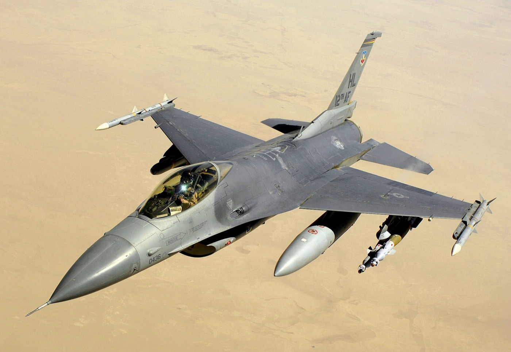
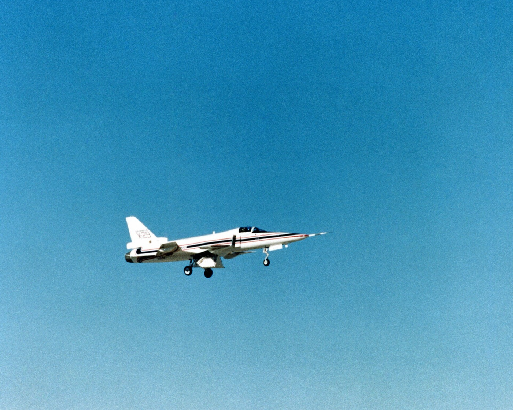
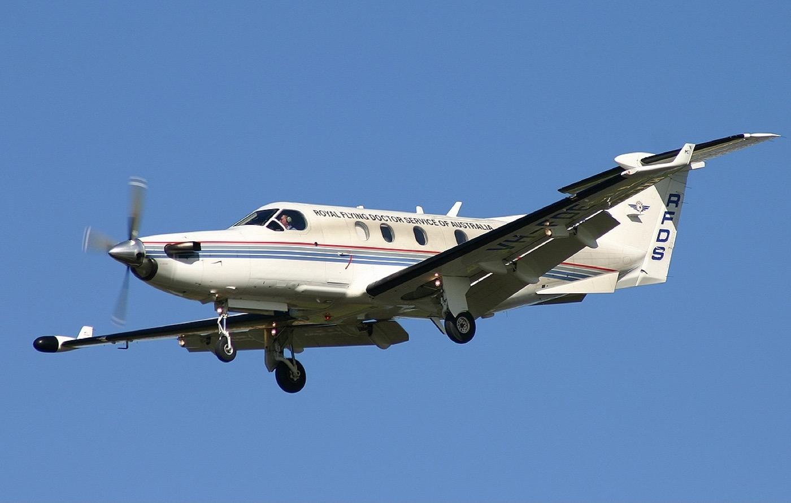
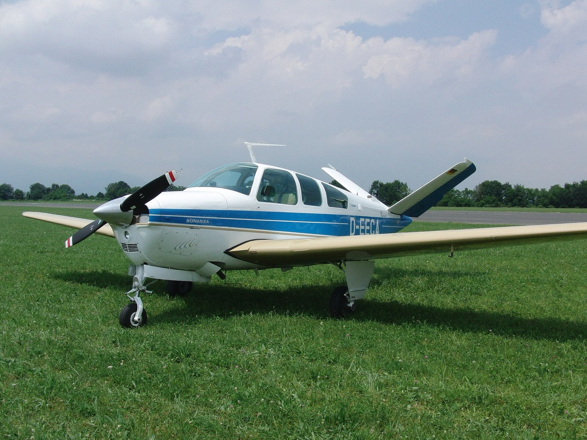
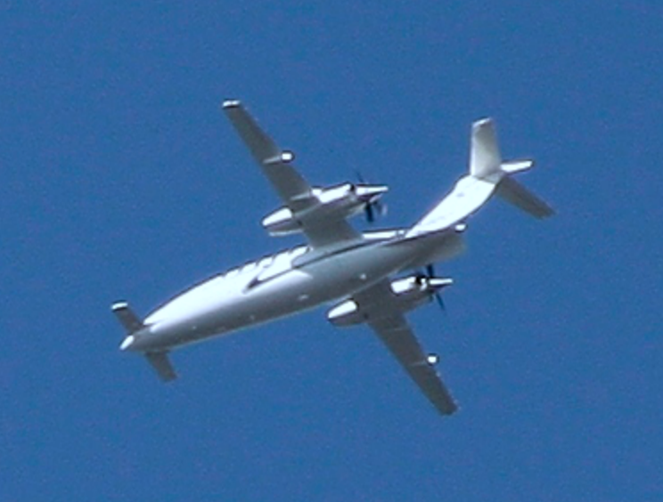

This is the second part of Lecture 10, *Stability and Control*. It builds the pitching moment about the CG and finds the neutral point and the static margin. It then draws the scissor plot of step 2. The scissor plot sizes the horizontal tail and sets the CG limits of . The page closes with step 3, the tail geometry and incidence. The figures are redrawn after the figures on the slides.

:::{note} What to take from this lecture
- The tail must outweigh the destabilizing moments of the wing, the fuselage, and the propulsion. The static margin measures by how much.
- The scissor plot gives the tail area for a CG range, or the CG limits for a tail area.
- The loading loop of step 1 must fit between those limits.
:::

## Pitching moment contributions

The pitching moment about the CG has four contributions: the wing, the fuselage, the propulsion, and the tail.

:::{math}
:label: eq-moment-sum
M_{cg} = M_{wing} + M_{fus} + M_{prop} + M_{tail}
:::

:::{figure} figures/cm-components.svg
:label: fig-cm-components
:alt: Pitching moment coefficient about the CG against angle of attack from minus 2 to 14 degrees, with invented slopes. Each line is labeled at its right end. The wing alone, the fuselage alone, and the propulsion alone are lines that rise with angle of attack. The tail alone is a line that falls steeply, from 0.21 to minus 0.31. The complete aircraft is a thicker line that falls from 0.12 to minus 0.09 and crosses zero at 7 degrees, marked as the trim angle of attack.
:width: 85%

The contributions to the pitching moment about the CG. Computed from invented slopes.
:::

{numref}`fig-cm-components` plots each contribution against the angle of attack. The wing with the CG aft of the wing aerodynamic center, the fuselage, and the propulsion ahead of the CG have a rising slope. They destabilize. The tail has a falling slope. It stabilizes. The tail must outweigh the other three, and the sum must cross zero at a positive $\alpha$.

The sources are Gudmundsson (2022), Section 24.2, and Nelson (1998), Chapter 2.

## The moment about the CG

:::{figure} figures/moment-about-cg.svg
:label: fig-moment-about-cg
:alt: A cambered wing section on the left and a smaller symmetric tail section far to the right, with the flow coming horizontally from the left. The wing lift acts upward at the wing aerodynamic center, with a curved arrow below it marking the wing pitching moment in the nose-up sense. The weight acts downward at the CG, a little behind the wing aerodynamic center. The tail lift acts upward at the tail aerodynamic center, with its own nose-up moment arrow. Dimensions mark the aerodynamic center and the CG from the wing leading edge, and the distance l t from the wing aerodynamic center to the tail aerodynamic center. A note reads positive moments: nose up.
:width: 90%

Forces and moments on the wing and the tail, moments drawn positive, nose up. Schematic.
:::

The wing lift $L^{W}$ and the tail lift $L^{T}$ act at the wing and tail aerodynamic centers, each with a moment about its own aerodynamic center ({numref}`fig-moment-about-cg`). With the fuselage and the propulsion added, the moment about the CG is

:::{math}
:label: eq-moment-cg
\textstyle\sum M_{cg} = M_{ac}^{W} + L^{W}\,(x_{cg} - x_{ac}) - L^{T}\,\big[l_t - (x_{cg} - x_{ac})\big] + M_{ac}^{T} + M_{fus} + M_{prop}
:::

Positions are measured from the leading edge of $\bar c$, and $l_t$ from the wing aerodynamic center.

## The coefficient form and the tail angle

Divide {eq}`eq-moment-cg` by $qS\bar c$. The tail sees the dynamic pressure $\eta_H\,q$:

:::{math}
:label: eq-cm-cg
C_{M,cg} = C_{M,ac}^{W} + \Big(C_{L}^{W} + \eta_H\frac{S_t}{S} C_{L}^{T}\Big)(\bar x_{cg} - \bar x_{ac}) - \eta_H V_H C_{L}^{T} + \eta_H V_H C_{M,ac}^{T}\frac{\bar c_t}{l_t} + C_{M,fus} + C_{M,prop}
:::

The {term}`tail volume coefficient` $V_H$, the tail lift coefficient, the tail angle of attack, and the downwash are

:::{math}
:label: eq-tail-lift
V_H = \frac{S_t\, l_t}{S\,\bar c}, \qquad C_{L}^{T} = C_{L\alpha}^{T}\,\alpha_t + C_{L\alpha}^{T}\,\tau\,\delta_e, \qquad \alpha_t = \alpha + i_t - \varepsilon, \qquad \varepsilon = \varepsilon_0 + \frac{\partial\varepsilon}{\partial\alpha}\,\alpha
:::

- Far behind the wing the downwash is $\varepsilon \approx 2\,C_{L}^{W}/(\pi AR)$, and its slope is $\partial\varepsilon/\partial\alpha \approx 2\,C_{L\alpha}^{W}/(\pi AR)$. $C_{L\alpha}^{W}$ comes from [Lecture 5](../lecture-05/wing-geometry-and-lift.md).
- $\eta_H$ is 0.85 to 0.95 in the wake of the wing.
- A symmetric tail has $C_{M,ac}^{T} = 0$.
- The fuselage term $C_{M,fus}$ is dropped on the first pass.

The form follows Sadraey (2013), Chapter 6. Gudmundsson (2022), Eqs. 24-74 and 24-89 to 24-94, measures the tail arm from the CG.

## Neutral point and static margin

The slope of $C_{M,cg}$ with the angle of attack is the pitch stiffness $C_{M\alpha}$:

:::{math}
:label: eq-cm-alpha
C_{M\alpha} = C_{L\alpha}(\bar x_{cg} - \bar x_{ac}) + C_{M\alpha,fus} - \eta_H V_H C_{L\alpha}^{T}\,\Big(1 - \frac{\partial\varepsilon}{\partial\alpha}\Big)
:::

$C_{L\alpha}$ is the lift-curve slope of the aircraft, wing plus tail:

:::{math}
:label: eq-cl-alpha-aircraft
C_{L\alpha} = C_{L\alpha}^{W} + \eta_H\frac{S_t}{S}C_{L\alpha}^{T}\,\Big(1 - \frac{\partial\varepsilon}{\partial\alpha}\Big)
:::

:::{prf:definition} Neutral point
:label: def-neutral-point

The {term}`neutral point` is the CG position at which $C_{M\alpha} = 0$. With the fuselage term dropped,

$$\bar x_n = \bar x_{ac} + \frac{\eta_H V_H C_{L\alpha}^{T}\,(1 - \partial\varepsilon/\partial\alpha)}{C_{L\alpha}}$$
:::

:::{prf:definition} Static margin
:label: def-static-margin

The {term}`static margin` is the distance from the CG to the neutral point, in chords:

$$SM = \bar x_n - \bar x_{cg} = -\frac{C_{M\alpha}}{C_{L\alpha}} = -\frac{\partial C_M}{\partial C_L}$$
:::

:::{figure} figures/static-margin-lines.svg
:label: fig-static-margin
:alt: Pitching moment coefficient about the CG against lift coefficient. Four straight lines start at 0.10 at zero lift. The line for a static margin of 0.21 falls most steeply and crosses zero at a lift coefficient of 0.48, marked as the trim lift coefficient. The lines for static margins of 0.14 and 0.07 fall less steeply. The line for a static margin of zero, with the CG at the neutral point, is horizontal.
:width: 75%

The slope of $C_{M,cg}$ against $C_L$ is the static margin. Schematic: here $SM = 0.10/0.48 = 0.21$ on the steepest line.
:::

{numref}`fig-static-margin` plots $C_{M,cg}$ against $C_L$ for four static margins. Moving the CG aft flattens the line, and with the CG at the neutral point the line is horizontal. The static margin is a design variable: a larger one gives more stability and less agility. The sources are Nelson (1998), Chapter 2, and Gudmundsson (2022), Eq. 24-132.

:::{iframe} ../quickcheck/neutral-point.html
:label: qc-neutral-point
:width: 100%

Quick check: the lift-curve slope of the aircraft, the neutral point, and the static margin from {eq}`eq-cl-alpha-aircraft` and the two definitions. Shuffle gives new values; the solution shows the steps.
:::

### Textbook example: the neutral point of a glider

Gudmundsson (2022), Example 24-6, computes the neutral point, the static margin, and the elevator derivative of a glider ({numref}`tbl-example-24-6`).

:::{table} A glider with a wing and a tail, and no fuselage. Gudmundsson (2022), Example 24-6. His $h$ is $\bar x$ here, and his tail arm runs from the CG.
:label: tbl-example-24-6

| Wing | Horizontal tail |
| --- | --- |
| $S$ = 40 ft², $\bar c$ = 2.0 ft | $S_t$ = 6.0 ft² |
| $AR$ = 10; aerodynamic center at 0.25 | $AR_t$ = 6, symmetric section |
| NACA 4412: $C_{L0}^{W}$ = 0.35, $C_{M,ac}^{W}$ = −0.1 | $i_t$ = 0, $\eta_H$ = 1 |
| CG at 0.52 | Tail arm from the CG 7.711 ft |
|  | Elevator chord ratio $E$ = 0.3 |

:::

1. $V_H$ = 6.0 × 7.711/(40 × 2.0) = 0.578.
2. $C_{L\alpha}^{W}$ = 5.151 and $C_{L\alpha}^{T}$ = 4.529 per rad; $\partial\varepsilon/\partial\alpha$ = 0.328.
3. $\bar x_n$ = 0.25 + 0.578 (4.529/5.151)(1 − 0.328) = 0.592, and $SM$ = 0.592 − 0.520 = 0.07.
4. $C_{M\alpha}$ = −0.372 per rad and $C_{M0}$ = −0.0057. Trim at 10° needs $C_{M0}$ = 0.065.
5. $\tau$ = 0.507 at $E$ = 0.3, and $C_{M\delta_e}$ = −0.0215 per deg as printed. Then $C_M = 0.065 - 0.0065\,\alpha - 0.0215\,\delta_e$, in degrees.

The definition of this page, with the arm from the wing aerodynamic center, gives a neutral point of 0.586. The example's elevator derivative (his Eq. 24-84) counts the CG offset twice; the form of [part 3](trim.md) gives −0.0232 per deg. The example uses Gudmundsson (2022), Eqs. 9-72 and 24-74 to 24-132.

This is the arithmetic of step 2. Repeat it with your loft before the vortex-lattice run.

## Choosing the static margin

Start from existing aircraft: {numref}`tbl-static-margins` gives their static margins, and {numref}`fig-cma-class` their $C_{M\alpha}$ by class.

:::{table} Static margins of existing aircraft. Brandt et al. (2004), Table 6.1.
:label: tbl-static-margins

| Aircraft | $SM$ |
| --- | ---: |
| Cessna 172 | 0.19 |
| Learjet 35 | 0.13 |
| Boeing 747 | 0.27 |
| P-51 Mustang | 0.05 |
| Convair F-106 | 0.07 |
| F-16A (early) | −0.02 |
| F-16C | 0.01 |
| Grumman X-29 | −0.33 |

:::

Check three criteria:

- $C_{M\alpha} < 0$ at the aft limit, that is, $SM > 0$.
- $C_{M0} > 0$. The aircraft then trims at a positive $C_L$ with the elevator near neutral at the design cruise.
- The trim $C_L$ and $\alpha$ lie inside the usable range at both CG limits.

In flight the CG moves as the fuel burns; between flights it changes with the loading case. The neutral point moves with the Mach number, the flaps, the ground effect, and the power.

:::{figure} figures/cma-by-class.svg
:label: fig-cma-class
:alt: Pitch stiffness, C M alpha per radian, against Mach number on a logarithmic axis from 0.05 to 2.6, for 22 points of existing aircraft, each labeled with its aircraft. A shaded band from minus 0.6 to minus 1.0 is labeled general aviation and business; a band from minus 1.2 to minus 1.7 is labeled transports. Inside the upper band: the Cessna 182, Navion, BD-5A, the Jetstar at Mach 0.6 and 0.8, the 747 at Mach 0.6 and 0.8, the CV-880 at Mach 0.8, the F-104 at minus 0.90 and minus 0.74, and the F-4 at Mach 2 at minus 0.61. Inside the lower band: the Salto, DHC-6, the 747 at Mach 0.3, and the 727-100 at two points. Above the bands: the A-4 near minus 0.4, the Bonanza at minus 0.46, the CV-880 at Mach 0.6 at minus 0.52, and the F-4 at Mach 0.6 at minus 0.28. Below: the Beech 18 at minus 1.75.
:width: 90%

$C_{M\alpha}$ of existing aircraft, selected rows. Values from Gudmundsson (2022), Table 24-2, after his Figure 24-16; bands from his Section 24.2.3.
:::

Two aircraft of {numref}`tbl-static-margins` fly near or below neutral stability. Photos via Wikimedia Commons.

::::{grid} 1 2 2 2

:::{card}

**General Dynamics F-16.** Fly-by-wire, with a static margin near zero. U.S. Air Force photo by Master Sgt. Andy Dunaway, public domain.
:::

:::{card}

**Grumman X-29.** Statically unstable, held by a digital flight control system. U.S. Department of Defense photo, public domain.
:::

::::

:::{admonition} Navy Jet Trainer
:class: navy

The RFP allows a statically stable or unstable configuration. The F-16C flies with $SM$ = 0.01 and the X-29 with −0.33, both with fly-by-wire. What must your flight control system do if you choose a negative static margin?
:::

## Step 2: the scissor plot

The {term}`scissor plot` shows the tail area ratio $S_t/S$ that each requirement needs, against the CG position (Torenbeek 1982, Section 9.5). Each requirement gives one line.

### Line 1: stability

1. Require $\bar x_n - \bar x_{cg} = SM$, with $\bar x_n$ from {prf:ref}`def-neutral-point`.
2. Write $V_H = (S_t/S)\,\bar l_t$, with $\bar l_t = l_t/\bar c$ fixed by the layout.
3. Let $A = \bar x_{cg} - \bar x_{ac} + SM$ and $k = \eta_H\,(1 - \partial\varepsilon/\partial\alpha)\,C_{L\alpha}^{T}/C_{L\alpha}^{W}$. Solve for the tail area ratio:

:::{math}
:label: eq-scissor-stability
\left(\frac{S_t}{S}\right)_{1} = \frac{A}{k\,(\bar l_t - A)}
:::

The line rises with $\bar x_{cg}$. For a given tail area ratio the CG must stay forward of the line: line 1 is an aft limit. $SM = 0$ gives the neutral-point line, and a larger static margin moves line 1 to the left.

### Lines 2, 3, and 4: control

The three control lines come from one relation. $C_{L}^{W}$ and $C_{L}^{T}$ are the wing and tail lift coefficients of the condition, and $C_{M,req}$ is the pitching moment the condition requires:

:::{math}
:label: eq-scissor-control
\frac{S_t}{S} = \frac{C_{M0}^{W} + C_{L}^{W}\,(\bar x_{cg} - \bar x_{ac}) - C_{M,req}}{\eta_H\,C_{L}^{T}\,\big[\bar l_t - (\bar x_{cg} - \bar x_{ac})\big]}
:::

:::{table} The three control lines, after Torenbeek (1982), Section 9.5. The $C_{M,req}$ column is an order-of-magnitude check for a jet trainer, not a value to adopt.
:label: tbl-scissor-lines

| Line and limit | Condition | $C_{L}^{W}$ | $C_{L}^{T}$ | $C_{M,req}$ |
| --- | --- | --- | --- | --- |
| 2: stall recovery, aft | $\alpha_{stall}$, CG at the aft limit, clean; elevator trailing edge down | $C_{L_{max}}$ | Positive, up: $C_{L\alpha}^{T}(\alpha_{t,stall} + \tau\,\delta_{e,max})$ | −0.12 to −0.23 |
| 3: takeoff rotation, forward | $V_R$, CG at the forward limit, takeoff flaps; nose-up about the main gear | $C_L$ at $V_R$ | −0.5 to −0.8, down | 0.10 to 0.20 |
| 4: landing approach, forward | $V_{app}$, CG at the forward limit, landing flaps; trimmed, elevator trailing edge up | $C_L$ at $V_{app}$ | −0.5 to −0.8, down | 0 |

:::

$C_{M0}^{W}$ is the pitching moment of the wing with the body at zero lift, at the flap setting of the condition; with flaps up it is close to $C_{M,ac}^{W}$. Use $C_{L}^{W} \approx C_L = W/(qS)$ at first. $V_R$ is the rotation speed and $V_{app}$ the approach speed. At the stall, $\alpha_{t,stall} = \alpha_{stall} + i_t - \varepsilon$.

The $C_{M,req}$ of each line comes from its condition. For line 2 it is $C_{M0}^{W} - C_{L_{max}}\,SM$; with $C_{L_{max}}$ of 1.4 to 1.8, $SM$ of 0.05 to 0.10, and $C_{M0}^{W}$ of −0.05, it runs from −0.12 to −0.23. For line 3 it is the nose-up moment that rotates the aircraft about the main gear at $V_R$, against the moment of the weight about the gear. For line 4 it is zero, because the aircraft is trimmed on approach.

### The plot

:::{figure} figures/scissor-plot.svg
:label: fig-scissor-plot
:alt: Tail area ratio against CG position in chords, with invented values. Line 1, stability at the chosen static margin, and line 2, stall recovery, rise to the right; line 1 lies above line 2. Line 3, takeoff rotation, and line 4, landing approach, fall to the right; line 3 lies above line 4 only left of a CG position of 0.417, where they cross at a tail area ratio of 0.056. A thinner dashed line for a static margin of zero, the neutral point, lies to the right of line 1. The feasible region above all four lines is shaded. A horizontal cut at a tail area ratio of 0.20 runs from line 3 at a CG position of 0.23, the forward limit, to line 1 at 0.41, the aft limit.
:width: 95%

The scissor plot. Computed from invented inputs: $\bar x_{ac}$ 0.25, $\bar l_t$ 3.0, $\eta_H$ 0.9, $SM$ 0.10, $C_{L_{max}}$ 1.6, $C_L$ 1.5 at $V_R$ and 1.2 at $V_{app}$, $C_{L}^{T}$ −0.7; $C_{M0}^{W}$ −0.05 clean, −0.20 with takeoff flaps, and −0.30 with landing flaps; $C_{M,req}$ 0.15 for line 3, 0 for line 4, and $C_{M0}^{W} - C_{L_{max}}\,SM$ for line 2.
:::

The feasible region is above every line. Lines 3 and 4 close it on the left, and lines 1 and 2 on the right. On each side the higher line governs. A cut is a horizontal line at the chosen tail area ratio $S_t/S$, between the two governing lines. Pick $S_t/S$, and the cut gives the CG limits; or pick the CG range of step 1, and the lowest cut that spans it gives $S_t/S$. The flaps move the lines. Draw one plot for each configuration.

:::{admonition} Navy Jet Trainer
:class: navy

This plot with your lines gives the criteria for horizontal tail sizing that the RFP asks for. The static margin is your team's choice. Which standard supports the value you chose?
:::

### A winning report

The University of Illinois 2025 undergraduate report (Team Draco 2025, Figures 49, 52, and 56 and Table 32) shows the deliverables:

- A scissor plot with aft-stability, landing, and rotation lines after Torenbeek, and the CG range at the chosen tail area ratio of 0.27 ({numref}`fig-uiuc-scissor`).
- The weight against the CG, and the static margin, for each segment of the patrol mission, inside the ±10% band of that year's RFP ({numref}`fig-uiuc-cg-sm`).
- Volume coefficients $V_H$ = 0.38 and $V_v$ = 0.07 with a dorsal fin, and the neutral point against Mach number.

Because the aircraft is fly-by-wire, the report sets no static-margin bound on the aft limit. Your deliverables are the same: the scissor plot, the CG and the static margin for each mission segment, and the tail arms.

:::{figure} figures/uiuc-scissor.svg
:label: fig-uiuc-scissor
:alt: The scissor plot of the University of Illinois 2025 report: horizontal tail area over wing area against CG position as a fraction of the MAC, from 0.2 to 0.8. The aft stability limit rises from a CG of 0.44 at zero tail area to 0.60 at a ratio of 0.5. The landing approach line falls from 0.45 at a CG of 0.2 to zero at 0.66, and the takeoff rotation line from 0.47 at 0.2 to zero at 0.54; landing lies above rotation right of 0.25. The feasible region above the lines is shaded. At the chosen ratio of 0.27 the operational CG range runs from 0.38, on the landing line, to 0.52, on the stability line.
:width: 70%

Scissor plot of a winning report: three lines after Torenbeek, and the CG range at the chosen 0.27. Values read from Team Draco (2025), Figure 52.
:::

:::{figure} figures/uiuc-cg-sm.svg
:label: fig-uiuc-cg-sm
:alt: Weight in pounds against percent of the MAC for the eleven segments of the report's patrol mission, squares for subsonic and triangles for supersonic segments. The CG moves aft as the weight falls, from 38% MAC at 30,600 lb, segment 1, to 52.5% at 16,000 lb, segment 11. The static margin stays between minus 7.5% and plus 9.5% MAC, inside a shaded band from minus 10% to plus 10% marked as the band of that year's RFP; it is negative at segments 6, 10, and 11.
:width: 85%

Weight against the CG and against the static margin for each segment of the patrol mission of a winning report. Values read from Team Draco (2025), Figure 49.
:::

## Steps 1 and 2 together

:::{figure} figures/scissor-and-envelope.svg
:label: fig-scissor-envelope
:alt: Two plots that share the CG position axis, from 0.15 to 0.5. Top, three labeled lines of the scissor plot: takeoff rotation falling to the right, and stability at the chosen static margin and stall recovery rising to the right, with the stability line the higher of the two. A horizontal cut at a tail area ratio of 0.20 runs from the takeoff rotation line at 0.23 to the stability line at 0.41. Bottom, the loading loop, weight over takeoff weight against CG position, from empty at 0.56 to MTOW at 1.00. Vertical dashed lines drop from the two ends of the cut to the lower plot, where they are labeled forward limit and aft limit. The loading loop lies between them.
:width: 75%

The cut of the scissor plot gives the limits of the CG envelope. Computed from the same invented inputs as {numref}`fig-scissor-plot`.
:::

Step 1 gives the loading loop of every loading case the RFP implies: the required CG range. Step 2 gives the cut at the chosen $S_t/S$: the allowed CG range. If the required range falls outside the allowed range, move the wing, lengthen $l_t$, raise $S_t/S$, or move weights. Every line shifts with $\bar x_{ac}$. Keep a margin.

## Step 3: horizontal tail geometry and incidence

Typical values are $AR_t$ of 3 to 5 and $\lambda_t$ of 0.3 to 0.6; fighters use 3 to 4 and 0.2 to 0.4. The tail sweep is about 5° more than that of the wing (Raymer 2018, Table 4.3). The span is $b_t = (AR_t\,S_t)^{1/2}$, and the chords follow as for the wing in [Lecture 5](../lecture-05/wing-geometry-and-lift.md).

Choose the incidence $i_t$ for zero elevator deflection at the design cruise. The exact value comes from the trim equations of [part 3](trim.md) with $\delta_e = 0$. A first estimate, with the wing $C_{L0}$ and the fuselage dropped and with $\alpha_{cr}$ the angle of attack at the design cruise ($\alpha_C$ in [Lecture 5](../lecture-05/wing-geometry-and-lift.md)), is

:::{math}
:label: eq-tail-incidence
i_t \approx \varepsilon_0 + \frac{C_{M,ac}^{W} + C_{M\alpha}\,\alpha_{cr}}{\eta_H V_H C_{L\alpha}^{T}}
:::

:::{table} Tail volume coefficients by class, with the arm from the wing quarter chord to the tail quarter chord. A check on the result of the scissor plot. Raymer (2018), Table 6.4.
:label: tbl-volume-coefficients

| Class | $V_H$ | $V_v$ |
| --- | ---: | ---: |
| Sailplane | 0.50 | 0.02 |
| Homebuilt | 0.50 | 0.04 |
| General aviation, one engine | 0.70 | 0.04 |
| General aviation, twin | 0.80 | 0.07 |
| Twin turboprop | 0.90 | 0.08 |
| Jet trainer | 0.70 | 0.06 |
| Jet fighter | 0.40 | 0.07 |
| Military cargo or bomber | 1.00 | 0.08 |
| Jet transport | 1.00 | 0.09 |

:::

The aircraft below show five tail arrangements. Photos via Wikimedia Commons.

::::{grid} 2 2 3 3

:::{card}

**Boeing T-45 Goshawk.** Conventional tail, mounted low: out of the wing wake after the stall. U.S. Navy photo by Lt. j.g. John A. Ivancic, public domain.
:::

:::{card}

**Pilatus PC-12.** T-tail. The risk is the deep stall. Photo by Chris Finney, [GFDL 1.2](https://www.gnu.org/licenses/old-licenses/fdl-1.2.html), via [Wikimedia Commons](https://commons.wikimedia.org/wiki/File:Pilatus_PC-12-45,_Royal_Flying_Doctor_Service_AN0636290.jpg).
:::

:::{card}

**Beechcraft Bonanza V35B.** V-tail: two surfaces, with mixed pitch and yaw controls. Photo by Fernando.tassone, [CC BY-SA 4.0](https://creativecommons.org/licenses/by-sa/4.0/), via [Wikimedia Commons](https://commons.wikimedia.org/wiki/File:Beechcraft_V35B_Bonanza.jpg).
:::

:::{card}

**Piaggio P.180 Avanti.** Three surfaces: the canard lifts and the tail trims. Photo by Ximeg, [CC BY-SA 3.0](https://creativecommons.org/licenses/by-sa/3.0/), via [Wikimedia Commons](https://commons.wikimedia.org/wiki/File:Piaggio_P.180_Avanti_above_Jena.jpg).
:::

:::{card}

**DHC-6 Twin Otter.** Conventional tail with a dorsal fin. The dorsal fin keeps $C_{n\beta}$ at large $\beta$ and prevents rudder lock. Photo by Timo Breidenstein, [GFDL 1.2](https://www.gnu.org/licenses/old-licenses/fdl-1.2.html), via [Wikimedia Commons](https://commons.wikimedia.org/wiki/File:WinAir_De_Havilland_Canada_DHC-6-300_Twin_Otter_Breidenstein.jpg).
:::

::::

The configuration comes from [Lecture 3](../lecture-03/configuration.md) and Gudmundsson (2022), Chapter 11. The method sizes any of them. Draw the tail on the three-view at its sized area before the trim of step 4.

### Textbook example: the Cessna 172 horizontal tail and fin

Gudmundsson (2022), Examples 11-1 and 11-2 and Eqs. 11-20 to 11-24, gives the volume coefficients of the Cessna 172, $V_H$ = 0.761 and $V_v$ = 0.0419. Its geometry is $S$ = 174 ft², $\bar c$ = 4.83 ft, $b$ = 36.0 ft, $l_t$ = 15.0 ft, and $l_v$ = 15.5 ft. The steps below use the arms of the aircraft as built; the examples themselves solve for an optimum arm.

1. $S_t = V_H\,S\,\bar c/l_t$ = 0.761 × 174 × 4.83/15.0 = 42.6 ft². The actual tail is 41.4 ft². With $AR_t$ = 3.0, $b_t = (3.0 × 42.6)^{1/2}$ = 11.3 ft.
2. $S_v = V_v\,S\,b/l_v$ = 0.0419 × 174 × 36.0/15.5 = 16.9 ft². The actual fin is 20.2 ft²: the published $V_v$ does not match the actual fin and arm. With $AR_v$ = 1.35, $b_v$ = 4.8 ft; the actual fin spans 5.2 ft.
3. The class values of {numref}`tbl-volume-coefficients` for a single-engine general aviation aircraft are 0.70 and 0.04. The 172 has 0.76 and 0.042.

:::{admonition} Navy Jet Trainer
:class: navy

Size the tail with the class values first. The scissor plot then gives $S_t/S$. How far is the $V_H$ of your scissor plot from the jet trainer row?
:::

:::{seealso}
Continue with : the trim equations, the elevator derivatives, the trim diagram, the conditions to check, and the trim drag. The references for the four parts are at the end of .
:::
